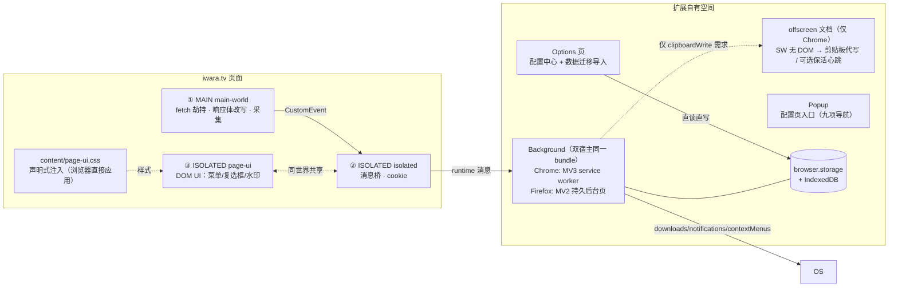

# IwaraAssistant 浏览器扩展实现方案

IwaraDownloadTool（油猴版，见 [mata.json](D:\code\IwaraDownloadTool\src\mata\mata.json)）的浏览器扩展化方案独立仓库。目标：**最大化利用扩展特权与架构**，把原脚本寄生在页面里的全部补丁机制（跨页同步、锁选举、注入式配置 UI、轮询定时器）下沉到扩展自有空间，并通过 **`browser` 命名空间**实现 Chrome / Firefox 跨浏览器。

## 核心原则

1. **能用平台能力就不自造**：锁 → 后台单例；定时 → `browser.alarms`；下载状态 → `browser.downloads.onChanged` 事件；配置 UI → 独立 options 页；RPC → 后台 `fetch` + `host_permissions: <all_urls>`（端点地址用户自填，无法事先枚举）。
2. **唯一的不可替代品**：页面主世界 fetch 劫持（改写站点看到的 `/videos` 响应体）——Chrome 平台无等价扩展 API，以 `content_scripts[].world: "MAIN"` 原生声明保留，且这是官方支持机制（Chrome 111+ / Firefox 128+）。
3. **`browser.*` 一码两浏览器**：按 [Chrome 官方 browser-namespace 指南](https://developer.chrome.com/docs/extensions/develop/concepts/browser-namespace)，统一 `browser` 命名空间 + 1 行运行时防护 shim（不引入 webextension-polyfill）。
4. **消息层全兼容写法**：`onMessage` 统一 `return true + sendResponse` 模式，规避 Chrome 148 之前不支持 promise 型监听器的差异。
5. **注入最小化**：页面常驻只有 MAIN/ISOLATED 两个薄壳（劫持转发 + 按需按钮），CSS 声明式注入，反馈走 `browser.notifications`，进度/队列/配置全在扩展页；首次运行引导浮层删除，改 options「使用引导」页签。
6. **分段注入，各取所需**（见下方「页内注入顺序」）：MAIN 世界只放「不改不行的部分」（fetch 劫持 + 响应体改写），ISOLATED 世界拆成「先桥接、后 UI」两段 —— 握手不被 35KB 的 UI 体积拖慢。**不再拆「更早的桩」**：`document_start` 已由平台保证先于页面任何脚本，再拆一段只会多出一个对页面可见的控制通道（安全净值转负）。

## 页内注入顺序（分段注入）

manifest `content_scripts` 数组顺序即执行顺序；前两条是**全站**钓鱼防护（`<all_urls>`），后三条只在 iwara 页面上跑，全部 `document_start`：

| #   | 产物                    | 世界     | 体积   | 职责                                                                                                                                                                                                                                                                |
| --- | ----------------------- | -------- | ------ | ------------------------------------------------------------------------------------------------------------------------------------------------------------------------------------------------------------------------------------------------------------------- |
| 0   | `content/guard-main.js` | MAIN     | ~1.3KB | 钓鱼防护（`<all_urls>`）：把 `fetch` / `XHR.open` / `WebSocket` / `EventSource` / `sendBeacon` / 表单 `submit` / `RTCPeerConnection` 换成抛错桩（补网络层规则下发前的窗口期、以及 DNR 管不到的 WebRTC），监听一次「继续访问」事件恢复原生引用；官方域名下直接不做事 |
| 0   | `content/guard.js`      | ISOLATED | ~4.9KB | 钓鱼防护：发 `GUARD_SYNC` 让后台裁决（网络层封锁在那里下），在 **closed shadow root** 里渲全屏警告，宿主被页面移除时补种；官方域名下零 DOM                                                                                                                          |
| 1   | `content/main-world.js` | MAIN     | ~7.4KB | 唯一不可替代品：包装 `window.fetch`，`/videos` 响应体改写、`/user/token` 与 Authorization 提取、HELLO 门闩。构建时 `skipGlobalsShim`，不向页面写入 `window.browser`                                                                                                 |
| 2   | `content/isolated.js`   | ISOLATED | ~4.4KB | 只做桥接：与 MAIN 握手、`runtime` 消息路由、cookie 上行。不背 UI 体积以缩短握手路径                                                                                                                                                                                 |
| 3   | `content/page-ui.js`    | ISOLATED | ~26KB  | 页内 UI：菜单 / 卡片复选框 / 水印 / overlay；与上一条共享 ISOLATED 世界全局对象                                                                                                                                                                                     |
| —   | `content/page-ui.css`   | 页面样式 | ~9KB   | **声明式注入**（挂在第 3 条的 `css` 上）：菜单 / 卡片 / 水印 / overlay / beautify / widescreen，浏览器在 `document_start` 期间、DOM 构建前应用                                                                                                                      |

### 样式：声明式，不进 JS

源项目（油猴版）把 CSS 写成 `src/css/*.css` 真实源文件，再由 `build/inlineCSS.ts` 在构建期内联成字符串，运行时 `GM_addStyle` —— 那是因为 userscript 没有声明式注入能力。扩展有这个能力，因此：

- 源文件仍是**真实 `.css`**：`src/content/css/{menu,videoCard,overlay,beautify,widescreen}.css`，由 `index.css` 用 `@import` 汇总
- 构建期 esbuild bundle 成 `content/page-ui.css`（`@import` 全部展开），不做二次字符串嵌入
- manifest `content_scripts[].css` 声明 → 浏览器自己注入，**运行时零 JS、零 `<style>` 节点**
- beautify / widescreen 改为**常驻规则 + `html.ia-*` 类作用域**，开关只切类，不再 `GM_addStyle` / 创建 `<style>`

收益：`page-ui.js` 从 36.3KB 降到 26.4KB（省下的 9.9KB 变成 `page-ui.css`，**总字节数基本不变** —— 收益不在体积，而在分工）；样式由 CSS 引擎直接应用，不再作为 JS 字符串常量参与解析、也不靠 `textContent` 赋值；声明式注入不存在「`document_start` 时 `head` 还不存在」这类时机问题。

时机证据（可自动化断言，不是“看起来挺早”）：

- `html[data-ia-hook]`（第 1 段写入，真实站点实测）：`readyState=loading;body=0;elements=0` —— 文档还在解析、`body` 尚未存在、`documentElement` 还是空的
- `html[data-ia-early]`（第 2 段写入）：`body=0;head=0;elements=0`
- 两者均由真实站点冒烟用例守护（`e2e/wdio/live/site.spec.ts`）

> 这两个属性属于「扩展在这」的指纹，对页面可见、也可被页面改写，因此**只写时序量**（`readyState` / `body` / `elements`），不写版本号、ID、token。需要更强隐蔽性时，可改为仅在 e2e 构建或 `enableUnsafeMode` 下写入。

### 安全模型（MAIN world 的固有边界）

MAIN world 与页面**同雷亚**，这是需求（改写站点可见的响应体）本身决定的，无法回避：

1. **钩子不可能对页面隐藏**。包装后的 `window.fetch` 可被 `fetch.toString()` 识别，页面也可直接重新赋值绕开我们。这是原生声明式 `world: "MAIN"` 的固有可见性，与 ScriptCat / Tampermonkey 注入同水平。
2. **因此 MAIN 世界里不能有任何秘密**，也不能暴露控制入口。曾有 `window.__iwaraAssistantFetchHook = { nativeFetch, queue, install }`：任何页面脚本都能在接管后调 `install()` 换掉我们的 handler，等价于 MITM 全部页面请求；而且 `queue` 里还暂存着含 `Authorization` 的 `init`。**已整体删除**，且真实站点用例现在反着断言：页面 `window` 上不得出现任何 `__iwara*` / `__ia*` 全局。
3. **握手走 CustomEvent，不走全局对象**。上下行都用 `MAIN_CHANNEL` 上的 `CustomEvent` + JSON 字符串，不把任何对象引用交给对方世界。
4. **业务判定以后台为准**。页内数据（响应体、token）仅用于「攒下载任务」，权限/去重/落库全在 background，不信任页面世界任何声称。
5. **例外（继承原脚本行为）**：`/user/token` 响应里的 refresh token 会写进页面 `localStorage`（原 userscript 靠它跨页共享会话）。这是**功能对齐的代价**，已在 [PRIVACY.md](PRIVACY.md) 声明；任何页面脚本本来就能读自己的 `localStorage`，因此不引入额外信任面，但也意味着无法承诺「token 不落到页面」。
6. **全站脚本只读主机名**：两个 guard 脚本是唯一在非 iwara 站点上运行的东西，且只读 `location.hostname`；官方域名下它们不建 DOM、不写全局、不改任何 API。

## 架构总览



详见 [docs/01-architecture.md](docs/01-architecture.md)。

## 文档导航

| 文档                                                | 内容                                                                       |
| --------------------------------------------------- | -------------------------------------------------------------------------- |
| [01-architecture.md](docs/01-architecture.md)       | 运行时上下文划分、职责矩阵、旧模块 → 新模块迁移映射                        |
| [02-cross-browser.md](docs/02-cross-browser.md)     | `browser` 命名空间采用策略、shim、浏览器差异矩阵（含已核验版本号）         |
| [03-manifest.md](docs/03-manifest.md)               | 双 manifest 模板、权限清单（全站 `host_permissions` 的两处用途）、构建派生 |
| [04-messaging.md](docs/04-messaging.md)             | 类型化消息协议、全兼容监听器写法、MAIN⇄ISOLATED 桥                         |
| [05-feature-mapping.md](docs/05-feature-mapping.md) | 油猴 `@grant` 能力逐项 → 扩展能力映射、删除项清单、新特权增项              |
| [06-roadmap.md](docs/06-roadmap.md)                 | M0–M6 里程碑、验收标准、e2e 与发布策略                                     |

## 已实现能力（对齐油猴版）

- **下载域**：路径模板与实时预览、链接预检（`checkDownloadLink` → 通知告警，可选同步复制保存文件名）、aria2 批量入队去重（`aria2.tellStatus` 过滤已存在 GID）、失败重试与队列持久化、词表过滤/名称清洗
- **页面域（`src/content/pageUi.ts`）**：页面类型识别（视频 / 视频列表 / 其他）、卡片复选框注入、跨标签页选区同步、本页全选/反选/取消本页/取消全部、手动 ID 输入、下载当前、Space 悬浮快捷键、播放列表移除、美化与宽屏、配置热更新、SPA 路由切换重扫、悬浮菜单（中/英/日）、右下角水印（应用名 + 版本 + 已选中数）
    - **逐项对齐油猴版源码**（不再自造控件）：
        - 复选框（`ui/widgets/checkbox.ts` + `css/videoCard.css`）：类名 `selectButton`、`input[videoID][videoName][videoAlias][videoAuthor]`、append 到 `a.videoTeaser__thumbnail` 的父元素末尾并置 `relative`、`accent-color:var(--primary);width/height:38px;right:0;top:22px;z-index:100`、点击 `stopImmediatePropagation`
        - 菜单（`ui/menu.ts` + `css/menu.css`）：`#pluginMenu > ul > li`、右侧中部滑出竖条、桌面 `mouseover` 展开 / `mouseout` 300ms 收起、触控点击切换 + 外部点击收起、`autoCollapseMenu=false` 常驻、SVG 箭头、`--body-dark/--text/--primary-dark` 主题变量、720/480/`pointer:coarse` 三档响应式（触控含 44/48px 触摸目标与斑马纹）、菜单项顺序与页面门控（Video 页含「下载当前视频」，其他页只剩手动下载；导出/导入配置与「打开设置」归扩展自有页面）
        - overlay（`css/overlay.css`）：`#pluginOverlay > .main`、全屏遮罩 + 淡入 + 面板入场动画、主题变量、圆角 14px、按钮 hover/disabled 态（源项目的「粘贴 JSON 导入配置」与其自定义勾选框**不移植**，配置导入导出在 options「迁移」页签）
        - 美化 / 宽屏（`beautify.css` / `widescreen.css`）：规则逐条移植到 `html.ia-beautify` / `html.ia-widescreen` 作用域（卡片 flex 等高 + 边框背景、内容区/标题/底部 padding、`.container` 85%、标题/作者 line-clamp、720px 回退）
        - 水印（`ui/widgets/watermark.ts`）：`p.fixed-bottom-right`，文本 `Iwara Assistant <version> 已选中 N`，`isDebug` 开启时追加调试标记；未开启时连续点击 5 次开启（写 storage 后 reload，与源项目同行为）
        - 卡片角标与删除（`ui/widgets/checkbox.ts`）：`.follow`（已关注作者）/ `.downloaded`（MediaCenter 已有）角标、`videoUploadTime` 属性、播放列表页每卡片 `.deleteButton`（仅所有者）——数据均来自后台本地库（`GET_CARD_META`，只读、不连外网）
    - 仍与油猴版不同（**均为有意取舍**，非欠债）：页面内 toast 引擎（油猴版 `toastify.ts`，页内反馈只走 `browser.notifications`）；页内「导出配置/导入配置/打开设置」三项（低频运维与导航，归 options「迁移」页签与工具栏弹窗）；页面内配置面板（已迁 options，不回退）；页面内下载进度条与好友审批面板（迁 options 页签）
- **钓鱼仿冒防护**：官方域名（`iwara.tv` / `iwara.zip` / `iwara.shop` / `iwara.ai`，含子域）之外的**任何包含品牌词的主机名**，都会在全屏警告的同时被**三层封锁**：① 后台通过 `declarativeNetRequest` session 规则在该标签页上拦住除顶层导航外的**一切**请求（图片 / 字体 / 表单 / beacon / 跨域 iframe / Worker）；② 页面 JS 层换掉 `fetch` / `XHR` / `WebSocket` / `EventSource` / `sendBeacon` / 表单提交 / `RTCPeerConnection`（补规则下发前的窗口期与 WebRTC）；③ 只有用户在警告面板里明确点「继续访问」，才解除封锁并在该标签页记住这个决定（关闭或离开即失效）。判定逻辑 `shared/site.ts` 有单测、后台状态机 `guardRules` 有单测，真实注入/拦截/放行有 Playwright 用例
- **社交域**：自动关注 / 自动点赞（随任务创建触发并写 IndexedDB）、好友请求批量审批（9 类条件、any/all 模式、证据采集与节流）
- **同步与集成**：全量投稿分页遍历（含 unlisted/private 解析、`syncProgress` 断点）、订阅同步、MediaCenter 推送（aria2 完成回调自动入库）、数据迁移（**旧脚本页面数据库自动检测 + 一键导入**（视频库/关注/好友/ID 映射；后台看不到页面 IDB，由 content script 分页读取 → 按体积/条数分批回传 → 后台按 32 MiB / 500 条一节建事务写入；任何一节写失败就二分隔离到单条，不让一条脏记录/超大记录废掉整批）；配置只能走粘贴/文件导入（旧脚本「导出配置」= 剪贴板里的**裸配置 JSON**，不是文件），因为它在油猴私有存储里）
- **界面多语言（runtime i18n）**：简体中文 / English / 日本語 三套字典（`src/shared/locales/*.json`），由 **i18next** 驱动，options、popup、页内菜单与水印、右键菜单、系统通知、后台错误文案**共用同一份实例**（`src/shared/i18n.ts`）；新装默认「跟随浏览器语言」，可在「高级 → 扩展行为 → 界面语言」切为固定语言，切换即时生效并持久化到 `config.language`（与 MediaCenter 同栈同配置：`{name}` 插值、`initAsync:false` 同步初始化）。**翻译没有中间层**：React 组件直接用 `react-i18next` 的 `useTranslation()`（实例经 `I18nextProvider` 注入，故 `react-i18next` 只进 React 包），content/background/非组件模块用 `i18n.t()`；键名与返回类型由 `src/shared/i18next.d.ts` 的 `CustomTypeOptions` 在编译期校验（拼错键直接编译失败）
- **未实现（有意延后）**：页面内下载进度条（油猴版 `features/progress.ts`）与好友审批页内面板（现走 options 页签）

## 参考骨架（reference/，历史快照）

> ⚠️ **已不是实现来源**：这是 M0 期手写的骨架级代码（双 manifest、browser shim、消息协议、background 调度、MAIN 劫持、ISOLATED 桥、options 占位的雏形），其中不少 `TODO` 后来已在正式实现里完成。**以 `src/` / `build/` / `manifest/` 为准**，`reference/` 不参与构建、测试与发布，仅作历史留存；读它前先确认与当前代码是否已漂移。

正式实现位于 `src/`（源码）、`build/`（esbuild 构建脚本 + 图标栅格化 + 打包）、`manifest/`（manifest 模板 + variants + `_locales`）。

### 目录结构

```
src/
  background/            下载调度中枢（MV3 service worker / MV2 持久后台页）
    index.ts             装配层：事件监听 + 启动恢复 + 消息路由（只做派发）
    storage/             本地状态唯一真源：configStore / queue / db / parse / cacheList
    iwara/               与站点交互：auth / videoApi / comments / interactions / playlists /
                         friendApprove / promoteAuthor / linkCheck / pageSync / mediaCenter
    download/            下载编排：dispatch / downloaders / downloadPath / adopt / cancel /
                         batch / cardMeta / queueActions / envCheck
    backends/            一个下载后端一个目录：aria2/{client,ws,tracker,recover}
                                             iwaradl/{client,tracker}
    runtime/             宿主能力：alarms / notify / clipboard / contextMenus / keepAlive / guardRules
  content/               页内脚本（manifest 入口即在顶层）
    mainWorld.ts         MAIN   ：fetch 劫持与 /videos 响应改写
    isolated.ts          ISOLATED：MAIN ⇄ 后台 桥接
    pageUi.ts            ISOLATED：页内 UI 启动与路由
    guard/               钓鱼防护三件套：main.ts / isolated.ts / protocol.ts
    page/                页内 UI 模块：selection / cardMeta / menu / watermark /
                         manualDialog / requests / config / dom / uiState
    css/                 声明式注入的样式（index.css 用 @import 汇总）
  options/               配置中心（React），tabs/ 一页签一文件
  popup/                 只做配置页入口
  messaging/             消息协议（protocol.ts 是唯一事实源）与 hub
  shared/                四个上下文共用的纯逻辑（叶子工具，平铺）
  offscreen/             Chrome 专用：剪贴板与保活心跳
  browser/               browser/chrome API 的 shim（构建期 inject）
  types/                 iwara 站点数据结构的 ambient 声明

build/                   构建：入口清单 + manifest 写入 + 图标栅格化 + ZIP 打包
manifest/                manifest 模板 + Chrome/Firefox variants + _locales
e2e/
  playwright/            Playwright（Chromium 直载 dist/chrome）
  wdio/                  WebdriverIO（Chrome + Firefox 同构；live/ 真实站点，manual/ 手动验收）
  types/                 两套共用的页面上下文全局声明
test/                    单元测试（node:test + tsx，文件名与被测模块同名）
docs/                    架构 / 跨浏览器 / manifest / 消息协议 / 功能映射 / 路线图
reference/               M0 骨架快照（不参与构建，勿当实现来源）
```

> 归位规则写在 [`docs/01-architecture.md`](docs/01-architecture.md#源码目录结构)：
> 同一概念只放一个文件；入口文件只做装配；一个下载后端一个目录。

## 快速开始（M0 已落地）

```bash
npm install
npm run build         # 双目标编译 + 商店包 → dist/chrome(.zip)、dist/firefox(.zip)
npm run build:chrome  # 仅 Chrome（MV3 service worker，只编译不打包）
npm run build:firefox # 仅 Firefox（MV2 持久后台页，只编译不打包）
npm run lint:firefox  # web-ext 静态检查（M5；当前 errors 0 / notices 0）
npm run package       # 仅重打包已有 dist（不重新编译）；package:chrome / :firefox 只打单目标
npm run build:icons   # 导出图标 PNG 到 assets/icons（构建不依赖它；`-- --size=512` 只出预览到 temp/icons）
npm run test:unit     # 单元测试（node:test，纯函数：路径/字符串/配置/路由/协议）
npm run test:e2e      # Playwright e2e（真实 Chromium 装载扩展；默认有头可旁观）
npm run test:e2e:headless  # Playwright 无头模式（CI；--headless=new + headless 一致下发）
npm run test:e2e:wdio      # WebdriverIO 跨浏览器 e2e（Chrome + Firefox 同一份用例）
npm run test:e2e:wdio:chrome   # 仅 Chrome
npm run test:e2e:wdio:firefox  # 仅 Firefox
npm run test:e2e:wdio:headless # WebdriverIO 无头模式（CI）
npm run test:e2e:wdio:live     # 真实站点 iwara.tv 冒烟（显式开关，非门禁）
npm run test:e2e:wdio:live:chrome   # 仅 Chrome
npm run test:e2e:wdio:live:firefox  # 仅 Firefox
npm run test:e2e:wdio:live:human    # 同上 + 人工过 Cloudflare（E2E_HUMAN=1）
npm run test:e2e:manual     # 手动验收：自动构建 + 装扩展 + 开页面，然后等你操作（Chrome）
npm run test:e2e:manual:firefox    # 同上，Firefox
npm run test:firefox:smoke  # web-ext run 装载冒烟（MV2 后台页 boot）
npm run format        # prettier 格式化（printWidth 9999，与源项目同一套规则）
npm run dev:chrome    # watch 模式（html/css/manifest 改动需重跑）；watch 不压缩，构建产物压缩
npm run type-check    # tsc --noEmit（src + build + manifest + test）
npm run type-check:e2e    # Playwright 用例与 fixture（e2e/tsconfig.json）
npm run type-check:wdio   # WDIO e2e 类型检查
```

> 需要环境变量的脚本一律写成 `node --import tsx/esm ./build/env.ts KEY=VALUE … -- <命令>`（见 `build/env.ts`）：
> `KEY=VALUE cmd` 的写法只有 POSIX shell 认，Windows 上原先靠 `node -e …execSync…` 复制了多份且引号规则各不相同。

### 版本号只有一个真源：`package.json`

`manifest.base.json` 里**没有** `version`——构建脚本写 manifest 时从 `package.json` 注入（`build/version.ts`）。发版就是 `npm version patch|minor|major`，不用再手改任何 manifest。

版本号不合法（预发布标识、前导零、段数超限、单段 > 65535、全零）会让构建**在清理 dist 之前**直接失败并说明怎么改。不静默清洗：悄悄把 `1.0.0-beta.1` 削成 `1.0.0` 会让 git tag 与商店版本对不上。详见 [docs/03-manifest.md](docs/03-manifest.md)。

### e2e（Playwright, MV3 扩展直载）

- 方案:Playwright 官方 chrome-extensions 路线——`launchPersistentContext` + `--load-extension`(固定 `chromium` 通道:品牌 Chrome 137+ 已移除 flags 侧载,考据见原仓库 `e2e/helpers/launchArgs.ts`);worker 级单会话,SW console 全程捕获
- 用例(40 个)：SW 启动标记 / options 九页签导航 / 过滤开关即时保存 + reload 持久化 / 路径模板实时预览 / **默认下载方式 = 浏览器内建（删掉存的 `downloadType` 用 schema 补默认值，等价新装）** / **同时下载数：写盘往返 + 控件带 1~10 边界** / 任务空态 / **popup 配置页入口（九项导航 + 深链）** / PAGE_READY 与 INIT_DOWNLOAD 真实消息链路(hub `return true` 模式)/ 任务队列表格实时渲染 / GET_VIDEOS / CHECK_LINK / GET_CARD_META / **队列操作消息（REMOVE_TASK / CLEAR_FINISHED / RETRY_TASK 均由后台执行 + 时间戳落盘）** / **任务页签筛选与操作按钮（running 禁止重试与移除）** / **队列操作 toast 多条堆叠与如实反馈** / **旧脚本页面数据库：自动检测 → 一键导入跨 origin 入库** / **迁移页粘贴导入：裸配置被识别为配置、完整包写入四表且如实计数、非法/无关 JSON 报错且不动现有配置** / **关注扩展作者默认开启 + 未登录不写状态（零请求路径）** / **界面语言：切换立即生效 + reload 仍在 + 页内菜单共用同一份配置** / **引导页：权限只诊断无按钮 + 钓鱼防护列出完整官方域名 + 更新日志标出当前版本** / **钓鱼防护：警告层 + JS 层拦 fetch** / **网络层封锁：图片 / 跨域 iframe / beacon / 表单请求根本没发出浏览器** / **页面自己派发继续事件不足以解封** / **真实点击继续后两层一起放行且刷新不再打扰** / **离开仿冒站后遗留规则被清除** / **官方域名：不注入警告层**
- 断言纪律：e2e 把浏览器语言钉到 **zh-CN**（Playwright `locale` + `--lang`；WDIO Chrome `--lang`；WDIO Firefox `intl.locale.requested`），因为界面文案走 i18n 且默认「跟随浏览器语言」——不钉语言则中文断言会随宿主环境漂移

### e2e（WebdriverIO, 跨浏览器）

- 前置：Node ≥ 22.19（WDIO v10 要求）；先 `npm run build`（双目标产物）；驱动由 chromedriver/geckodriver devDeps 提供
- 方案:WebdriverIO v10 + WebDriver BiDi,同一份 `e2e/wdio/extension.spec.ts` 在 Chrome + Firefox 各跑一遍(**24 用例 × 2 宿主，其中撤销权限用例仅 Firefox 执行**),覆盖范围覆盖并超过 Playwright 版,补齐 Firefox UI 自动化
- 用例(24 个):后台启动(BACKGROUND 上下文 + 周期 alarms)/ options 九页签 / 九页签逐个切换 + hash 深链 / 过滤开关即时保存 + reload / 路径模板实时预览 / 任务页空态 / **popup 配置页入口（九项导航）** / PAGE_READY / GET_VIDEOS / CHECK_LINK / GET_CARD_META / INIT_DOWNLOAD 失败路径 / **队列操作消息(REMOVE_TASK / CLEAR_FINISHED / RETRY_TASK)** / 好友请求页(审批条件与模式)/ 高级页(批量入库与 MediaCenter)/ **迁移页旧库导入区块 + 配置导出按钮（按标题定位）** / **迁移页粘贴裸配置 JSON 即可导入（双宿主）** / **迁移页粘贴 36 MiB 完整包（验证事务预算在双宿主都成立）** / **任务队列表格实时反映 storage 变更** / **引导页全站权限徐章与 `contains({origins:['<all_urls>']})` 一致、无授权按钮** / **钓鱼防护：declarativeNetRequest session 规则可用（加/查/删）** / **子目录：`downloads.download` 按 filename 里的 `/` 真实建目录（回归「Firefox 扁平化」旧结论）** / **Firefox 撤销全站权限 → 徐章变「已撤销」+ 提示回扩展管理页恢复**

### options 配置页与队列的交互约定

- **保存反馈全局化**：`saveConfig` 直接调 sonner 的 `toast`（`src/options/appStore.ts`），任何页签保存都有反馈；保存类 toast 固定同一个 `id`（覆盖式更新）与 `testId`（e2e 契约），常量紧贴调用点
- **toast 用 sonner 而不是自绘**：通知本质是队列而非单值（保存、队列重试/清理、迁移导出会并发）；错误文本需要可关闭、可停留阅读；aria-live / 键盘可达 / reduced-motion 由库提供。页面只挂一个 `<Toaster>`（`src/options/toaster.tsx`，只放主题/位置/a11y 配置），业务代码直接 `import { toast } from 'sonner'`，不再套一层 `notifyXxx` 包装。content script 一律不引 React，页内反馈仍走 `browser.notifications`
- **乐观反馈**：校验通过立即显示「已保存」，storage 写入失败再覆盖为错误——避免「点了没反应」，同时让自动化断言不必等待异步写盘
- **输入防抖 400ms**：路径模板等文本框停止输入后才写 storage（旧实现逐字符写盘并广播 `CONFIG_SYNC` 到所有 iwara 页）；失焦或切页签时立即提交，不丢输入
- **队列可操作**：任务页签支持 状态筛选（全部/进行中/失败/已完成）、排序（进行中优先 + 最近更新优先）、行内重试/移除、批量「重试全部失败 / 清除已结束」（内联二次确认，不用 `window.confirm`）
- **写操作全部经后台**：`RETRY_TASK / REMOVE_TASK / CLEAR_FINISHED / RETRY_FAILED` 都是消息请求，页面侧绝不直接改 `storage.downloadQueue`（后台是唯一写者，直写会与内存副本冲突）
- **IndexedDB 写入必须分节**：体积上限是**每个事务**而不是每条记录（Firefox `dom/indexedDB` 在单次写事务/响应超过约 246 MiB 时抛 `The serialized value is too large`），一期视频库又会存简介等大字段。批量入库一律走 `bulkPutIsolated`（32 MiB / 500 条一节，每节独立事务——预算按「真实上限的 1/3 左右」定，切太碎反而是大库导入的主要耗时项），写失败则二分到单条、把脏记录计成 `failed` 而不是静默吞掉整批；读取端同样不许 `getAll()` 整表，改按键区间分页（`src/shared/legacyDb.ts` 是这两套预算的唯一来源）
- **running 的移除 = 先取消下载器再删记录**：`shared/cancelStrategy.ts` 判定能否撤销（browser 有下载 id / aria2 有 gid 且端点已配置 → 先 `cancel` 或 `remove` + `removeDownloadResult` 并复核）；iwaradl/others 没有撤销接口 → 删记录但如实提示「可能仍在下载」；仍在传输时保留任务并提示原因
- **时间信息**：`QueueTask.createdAt/updatedAt` 由后台在入队与每次状态变更时写入，面板据此显示「入队/更新 x 分钟前」并排序
- **浏览器内建下载有「同时下载数」上限**（`browserConcurrentDownloads`，1~10，默认 3）：`downloads.download()` 一返回传输就在浏览器里跑，批量投递并不会等上一个下完，所以不设限时勾 20 个就是 20 条并发打向同一 CDN。超出的任务落 `queued` 排队（UI 显示「排队中」），由 `download/browserQueue.ts` 的泵在 `downloads.onChanged` 收到终态时自动启动。**刻意不写成「等信号量再返回」**——那会把消息处理器挂住（第 4 个要等前 3 个下完，Chrome 对单事件还有 5 分钟上限）。aria2 / iwaradl 不受此限制，它们自己管并发
- **单一设计系统**：`src/options/options.css` 顶部 `:root` 定义色板/圆角/字体 tokens（`--bg / --surface / --border / --accent / --ok / --warn / --danger` 等），form 控件、按钮、徽章、表格全部走同一套；popup 复用同一份 tokens（`src/popup/popup.css`），避免两个自有页面像两个产品。文件头部注释列了 e2e 依赖的类名契约（`.row / .toggle / .check-row / code.preview / table.tasks / .pill-* / [data-testid="save-toast"]`），改样式前先看那段
- **所有可点击控件的行内高度是同一个数（34px）**：`input` / `select` 用 `padding: 7px + line-height: 1.4`，`.card button` 与 `.file-picker` 必须用同样的内边距与行高。按钮曾经是 `line-height: 1.3`（32px），与并排的输入框差 2px——数据表里一眼就能看出来；`.file-picker` 曾经是 10px 内边距（48px），和同一行的按钮差 14px。改这三条规则中的任何一条都要一起改另外两条
- **文案语言统一**：所有界面文案（options / popup / 页内菜单 / 系统通知 / 右键菜单）都走 `src/shared/locales/*.json` 字典，`t()` 的键名是编译期联合类型（写错键 / 漏翻直接报错或单测失败）；`browser.i18n` 只服务 manifest 层（`_locales` 只剩 `extName`）
- **实验性功能真实门控**：MediaCenter 联动区块只在 `config.experimentalFeatures` 开启时渲染（旧实现常驻但 note 写着「开启后才有」）

> WDIO 断言注意：`expect($('[data-testid="save-toast"]')).toHaveText()` 对**淡入中**的元素返回空串（W3C `getElementText` 在元素尚未被视为已渲染时返回 `""`），必须用 `browser.waitUntil` + `execute` 读 `textContent` 轮询（见 `e2e/wdio/extension.spec.ts` 的 `waitForSaveToast`）。

- 后台活性判定与 Playwright 的差异:Playwright 读 SW console 文本(仅 Chrome 可捕获);WDIO 改用两端一致的 `runtime.getContexts()` + `alarms.getAll()`(语义更强,且天然跨浏览器)
- 扩展装载(`e2e/wdio/helpers/extension.ts`):
    - Chrome 136+:BiDi `webExtension.install` 需 `--enable-unsafe-extension-debugging --remote-debugging-pipe --user-data-dir=<非默认目录>`;品牌 Chrome 137+ 已移除 `--load-extension`,不再用启动参数侧载
    - Firefox:BiDi `installExtension` + geckodriver `--allow-system-access`(FF 138+ 导航 `moz-extension://` 页必需);prefs 预置 `extensions.webextensions.uuids` 固定运行时 UUID
- 挂载点:`wdio.conf.ts`(双 capability + 无头开关)/ `e2e/wdio/extension.spec.ts`(同构断言)/ `e2e/wdio/helpers/extension.ts`(装载 + 后台活性/消息/存储等跨浏览器工具);扩展按 session 幂等安装
- 环境变量:`E2E_HEADLESS=1` 无头、`WDIO_BROWSER=chrome|firefox` 单宿主(已封装为 npm scripts)

### e2e（真实站点冒烟 iwara.tv）

扩展页套件测不到「宿主 DOM 是否还能被注入」——站点改版、Cloudflare 风控、MAIN 世界握手，只能在真站点上验。策略对齐源用户脚本项目 IwaraDownloadTool 的 e2e 实践：

- **显式开关**：`E2E_LIVE=1` 才收集 `e2e/wdio/live/` 下的 spec；常规套件与 CI 完全不碰真实站点
- **单会话 + 串行 + 单标签**：整包只在 `before` 里加载一次 `/videos`，之后站内导航；反复冷启动/反复加载首页是 CF 风控评分的最大诱因
- **反自动化指纹（仅 live / manual）**：Chrome 追加 `--disable-blink-features=AutomationControlled`；Firefox 置 `dom.webdriver.enabled=false` + 页面 console 打进程 stdout
- **挑战不当缺陷**：检测到 Cloudflare 挑战（正文特征 + turnstile frame）即 `skip` 整套并打印现场；只有在「挑战已过但注入没生效」时才算失败
- **人在回路**：`E2E_HUMAN=1` 时交互式挑战留给人工点选（预算 `E2E_HUMAN_TIMEOUT`，默认 10 分钟）
- **状态驱动 + 失败现场**：所有等待都是 DOM 条件轮询（无固定 sleep）；失败先 dump 页面快照（URL/标题/握手标记/卡片数/复选框数/菜单项/正文摘要）
- **零副作用**：只做 UI 级交互（开关选择框 / 全选 / 反选 / 取消本页 / 取消全部 / 手动下载框开合）——**不点**「下载所选」「下载当前视频」
- 用例（13 个 × 2 宿主）：MAIN 世界握手（`html[data-ia-bridge=ready]`）/ **注入时机标记**（`data-ia-hook` / `data-ia-early` 证明早于页面脚本，并反向断言页面无任何 `__iwara*`/`__ia*` 控制入口）/ 卡片复选框数与卡片数一致 / **复选框契约**（`selectButton`、`videoID` 等属性、插入点与 computed 样式、`accent-color` 取自站点 `--primary`）/ **卡片元数据回填**（`videoUploadTime` 来自后台视频库，证明「fetch 拦截 → INGEST 入库 → GET_CARD_META」整条链路通）/ **hover 展开接线**（`mouseover` → `expanded`，`mouseout` 后 300ms 收起）/ 菜单项顺序与源项目一致（导出/导入配置与「打开设置」有意不搬进页内）/ **菜单 + 水印契约**（`#pluginMenu>ul>li`、`fixed/right:0`、`--body-dark` 主题色、水印 `fixed-bottom-right` + 版本 + 已选中数 + `--body/--text`）/ 全选→反选→取消全部闭环 / 手动下载 overlay 开合 / 详情页出现「下载当前视频」且无播放列表删除项 / 真实 SPA 导航（点卡片 pushState 进详情页，菜单重建且窗口标记不失）
- 环境变量：`E2E_LIVE=1`、`E2E_SITE_URL`（默认 `https://www.iwara.tv`，可指向自建反代）、`E2E_LIVE_LIST_PATH`（默认 `/videos`）、`E2E_HUMAN=1`

### e2e（手动验收：装好就停，人来操作）

自动套件断言「代码是否符合预期」，但系统通知的点击手感、真实账号下的下载/关注、Cloudflare 过盾、
权限被撤销后的界面表现，这些只能人眼看。手动模式把「构建 + 装扩展 + 开浏览器 + 开页面」自动化，
其余全部交给人工：

- `npm run test:e2e:manual`（Chrome，默认）/ `npm run test:e2e:manual:firefox`
- 命令先 `build:<target>` 再启动：**不会出现「改了代码、验收的却是旧产物」**
- 启动后是有头窗口且扩展已装载；起始页默认 `https://www.iwara.tv/videos`，终端同时打印扩展 ID、
  配置页与弹窗页地址（同一浏览器新标签粘贴即可）
- 结束方式：**关掉浏览器就正常通过**（推荐）；或到达预算（`E2E_MANUAL_TIMEOUT`，默认 1 小时）自动结束。
  Ctrl+C 会立即中断运行（退出码非 0，属正常中止，不当失败看）
- 关浏览器为什么不能「走正常收尾」：会话随浏览器一起消失，WDIO 的 `endSession` 会得到 `no such session`
  并把本次运行标红（Chrome/Firefox 实测都会，清 `sessionId` 也拦不住），所以由 helper 主动以 0 退出
- **不做任何断言**：它只判断「部署成功」。需要断言的行为仍应写进 `e2e/wdio/extension.spec.ts` 或 live 套件
- 环境变量：`E2E_MANUAL_PAGE=site|options|popup`（起始页类型）、`E2E_MANUAL_URL`（任意绝对地址，优先级最高）、
  `E2E_MANUAL_PATH`（站内落地页，默认 `/videos`）、`E2E_MANUAL_TIMEOUT`、`WDIO_BROWSER`
- **登录态复用**：Chrome 用固定 profile `temp/manual-profile/chrome`（`E2E_MANUAL_PROFILE` 可改），
  下次手动验收不用重新登录；Firefox 的 profile 仍由 geckodriver 每次新建
- 提示「user data directory is already in use」= 上次 Chrome 没退干净，删掉 `temp/manual-profile` 再跑

### e2e（真实下载链路：站点 → 扩展 → aria2）

`e2e/wdio/live/download.spec.ts` 用真实账号与真实 aria2 跑通一条完整链路，验证的是「扩展页套件与站点冒烟都覆盖不到的那一段」：

- 链路：`iwara.tv` 视频页 → `videoApi` 取直链 → 令牌交换（`POST /user/token`，refresh token 只经环境变量进入）→ `INIT_DOWNLOAD` → 下载器按配置路径模板投递 aria2（`aria2.addUri` 带 `dir`/`out`）→ aria2 JSON-RPC/WebSocket 回传进度 → 完成事件写回队列
- 断言全部落在**事实**上：aria2 侧 `tellStatus` 的 `gid`/`files[0].path`/`completedLength === totalLength`，扩展侧队列按**本次 `taskId` 精确匹配**（同 `videoId` 的历史任务不参与断言）→ `status: 'complete'`
- 追踪收敛：先等 20s WebSocket 通知；若未到则发 `SYNC_DOWNLOAD_TASKS` 主动对账再等 20s——覆盖「通知丢失」这条真实路径，而不是把等待时间拉长
- 环境变量：`E2E_LIVE=1`、`E2E_LIVE_REFRESH`（refresh token）、`E2E_LIVE_ARIA2_TOKEN`、`E2E_LIVE_ARIA2_PATH`（默认 `127.0.0.1:6800`）、`E2E_LIVE_DOWNLOAD_PATH`、`E2E_LIVE_KEEP_TASK=1`（保留任务便于排查）
- **Firefox 注意**：扩展页访问**非回环**的内网 http（如 `10.0.0.165:6800`）会被浏览器的本地网络访问策略拦掉（`NetworkError`，与主页权限无关，pref 也关不掉——实测记录见下），只能走 `127.0.0.1` 或 https（`ws://` 同理）；配置页会给出可操作提示，详见 [docs/02-cross-browser.md](docs/02-cross-browser.md)
- 不覆盖（分层边界）：自动关注/点赞/好友审批（需登录态且会改账号数据）、MAIN 世界对 `/videos` 响应体的改写结果（需账号缓存窗口比对，此处只验握手段）。真实下载链路单独成组（见上一节 `download.spec.ts`）
- **真实冒烟拓出的真缺陷**（扩展页套件永远碰不到）：
    1. 复选框注入死锁：`refreshCards()` 用「DOM 里是否已有复选框」反推开关键，而注入永远从零开始 → 32 张卡片一张不注入。已改为显式意图开关 `injectionOn`
    2. SPA `pushState` 导航不触发 `popstate`/`hashchange` → 点卡片进详情页后菜单仍是列表页形态（无「下载当前视频」）。已改为复用 DOM 变更观察器比对 URL 后重建
    3. 菜单收起态只剩下 26px 可见条时，WebDriver 无法用 `moveTo` 悬停（元素中心在视口外）；高 DPI 下 `origin:'viewport'` 坐标也被按物理像素解释。改为「hover 接线用事件同步断言 + 展开态用类切换 + 真实点击」双段验证
    4. Chrome 窗口被遮挡时会暂停 CSS 过渡（occlusion 降级），`computed transform` 永停在收起值（连 `transform:none` 都读不到）——启动参数加 `--disable-backgrounding-occluded-windows --disable-renderer-backgrounding --disable-features=CalculateNativeWinOcclusion`，测试侧再关过渡保确定性
    5. **站点用协议相对 URL 调 API**（`fetch('//api.iwara.tv/videos?...')`）：`new URL(raw)` 无 base 直接抛 TypeError，拦截器把它当「非法 URL 放行」→ 入库/token 捕获/点赞过滤/缓存回填**全部静默失效**且页面表现完全正常。已抽出 `shared/requestUrl.ts`（带 `document.baseURI` 基址，对齐源项目 `String.prototype.toURL()` 对 `//` 的处理并覆盖相对路径），由真实站点用例 + 单元测试双重守护

装载验收（docs/06 M0）：

- Chrome 111+：`chrome://extensions` → 开发者模式 → 加载已解压的扩展程序 → 选 `dist/chrome`
- Firefox 128+：`about:debugging#/runtime/this-firefox` → 临时载入附加组件 → 选 `dist/firefox/manifest.json`
- 打开任意 iwara.tv 页面，页面 console 应出现 `[iwara-assistant] MAIN world injected — fetch hook active` 与 `[iwara-assistant] ISOLATED bridge ready (schema 1)`（随后 `handshake ok`）；扩展 SW/后台页 console 出现 `[iwara-assistant] background up (chrome-service-worker | firefox-background-page)`
- 图标：唯一设计源是 `assets/icons/logo.svg`，`npm run build` 经 @resvg/resvg-js 栅格化成 `dist/<target>/icons/icon-{16,48,128}.png`（无需手工步骤；`npm run build:icons` 仅用于另存一份到 `assets/icons/` 供查看或上架）

## M5 Firefox 专项结果

- `npm run lint:firefox`（web-ext 8.10）对 `dist/firefox`：**errors 0 / notices 0**；4 条 `UNSAFE_VAR_ASSIGNMENT`（innerHTML）warning 全部位于 react-dom 产品构建内部 `setInnerHTML`（`dangerouslySetInnerHTML` 处理器，本项目组件零使用）——打包库固有告警，AMO 不阻断签名
- manifest 已声明 `data_collection_permissions: { required: ['none'] }`（Firefox 141+ 数据收集披露；本项目不向开发者回传任何数据）
- 挂起协议与 X-ray 纪律代码复核通过（见 docs/01/04；跨世界仅 JSON 字符串、无 while+sleep、SW 四类事件唤醒）

## M6 发布（已就绪）

- 打包：`npm run build` 编译完自动打包 → `dist/chrome.zip`（CWS）/ `dist/firefox.zip`（AMO）；只想重打包已有产物用 `npm run package`（或 `package:chrome` / `package:firefox` 单目标）。手写 ZIP：条目路径强制正斜杠（规避 Compress-Archive 反斜杠分隔符兼容问题）、manifest.json 恒在包根。
- 正式图标：唯一设计源是 `assets/icons/logo.svg`（完整图标：底板、渐变、字形都在里面，设计工具可直接编辑）；构建期由 `build/iconRenderer.ts` 调用 @resvg/resvg-js 栅格化成 16/48/128 PNG，16px 也走同一份源文件。**为什么不能直接用 SVG**：Chrome 的 manifest `icons` 明确不支持 SVG（只收 PNG/BMP/GIF/ICO/JPEG），Chrome Web Store 要求 128×128 PNG。小尺寸的可读性由 SVG 设计本身保证——线条与细节不要细到 1px 以下。
- Firefox 自更新路线（可选）：设 `IWARA_ASSISTANT_UPDATE_URL` 环境变量重建 → manifest 注入 `gecko.update_url` → `web-ext sign` 自签；默认走 AMO 上传审核路线。
- 商店素材与逐权限审核说明：见 [docs/store-listing.md](docs/store-listing.md)；隐私声明：[PRIVACY.md](PRIVACY.md)（不收集任何数据，对应 Firefox `data_collection_permissions: none`）。

## 从油猴脚本迁移

1. 旧脚本（IwaraDownloadTool）菜单里的「导出配置」会把**配置 JSON 复制到剪贴板**（源项目没有「导出全部数据」文件）。
2. 装载本扩展（Chrome 加载 `dist/chrome`；Firefox 经 AMO 或临时载入 `dist/firefox/manifest.json`）。
3. options → 「迁移」页签，两条通道各管一段：
    - **库存四表**（视频库/关注/好友/ID 映射）：打开（或刷新）任意 iwara.tv 页面会自动检测旧库，回迁移页点「导入这 N 条数据」一键拉取（按 ID 合并，不删除现有数据）。
    - **配置**：把第 1 步复制的内容粘贴到文本框 → 「导入粘贴内容」；也支持选择 JSON 文件。旧脚本的配置在油猴私有存储里，页面数据库读不到，只能走这条。
    - 本扩展自己导出的完整迁移包（文件或剪贴板）同样可以粘贴/选文件再导入。
4. 浏览 iwara 验证过滤/回填与右键下载正常后，禁用油猴脚本。迁移期建议油猴脚本与扩展保持并行一个发布周期，异常可随时回退。

## 技术底座

- TypeScript + esbuild（沿用原仓库工具链习惯，`tsx` 跑构建脚本）
- `idb`（IndexedDB 视频库整体迁后台）、`dayjs` 保留
- Playwright（Chromium 扩展 e2e）+ WebdriverIO（Chrome/Firefox 跨浏览器扩展 e2e）

## 许可证

[Apache License 2.0](LICENSE) © 2026 dawn-lc
