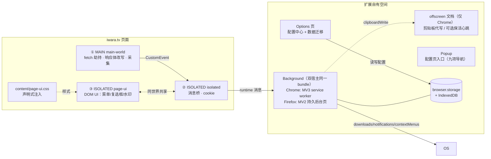

# IwaraAssistant

IwaraAssistant 是 iwara.tv 的浏览器扩展：批量下载与管理视频、在页面内完成选择与下载、用系统通知反馈结果，并通过扩展自有页面管理配置、队列与迁移。Chrome 使用 MV3，Firefox 使用 MV2，共用同一份代码与 bundle。

## 核心原则

1. **能用平台能力就不自造**：后台单例替代跨页锁；`browser.alarms` 替代轮询；`downloads.onChanged` 驱动任务状态；配置与队列放在扩展自有页面。
2. **唯一的不可替代品**：页面主世界 fetch 劫持（改写站点看到的 `/videos` 响应体）。Chrome / Firefox 均无等价的扩展 API，因此以 `content_scripts[].world: "MAIN"` 原生声明保留。
3. **`browser.*` 一码两浏览器**：按 Chrome 官方 browser-namespace 指南统一使用 `browser`，并以 1 行运行时 shim 兼容 Chrome 111+ 与 Firefox，不引入 polyfill。
4. **消息层全兼容**：`onMessage` 统一 `return true + sendResponse` 模式，避开 Chrome 148 之前不支持 promise 型监听器的差异。
5. **注入最小化**：页面常驻只有 MAIN/ISOLATED 薄壳（请求拦截 + 按需 UI），CSS 声明式注入；状态反馈走 `browser.notifications`，进度、队列与配置全在扩展页。
6. **分段注入**：MAIN 世界只放「不改不行」的部分；ISOLATED 拆成「先桥接、后 UI」两段，握手不被 UI 体积拖慢。

## 架构总览



详见 [docs/01-architecture.md](docs/01-architecture.md)。

## 页内注入顺序

manifest `content_scripts` 数组顺序即执行顺序；前两条是**全站**钓鱼防护（`<all_urls>`），后三条只在 iwara 页面上运行，全部 `document_start`：

| #   | 产物                    | 世界     | 职责                                                                                                                                                                                                                                |
| --- | ----------------------- | -------- | ----------------------------------------------------------------------------------------------------------------------------------------------------------------------------------------------------------------------------------- |
| 0   | `content/guard-main.js` | MAIN     | 钓鱼防护（`<all_urls>`）：把 `fetch` / `XHR.open` / `WebSocket` / `EventSource` / `sendBeacon` / 表单 `submit` / `RTCPeerConnection` 换成抛错桩，补网络层规则下发前的窗口期与 DNR 管不到的 WebRTC；监听「继续访问」事件恢复原生引用 |
| 0   | `content/guard.js`      | ISOLATED | 钓鱼防护：请求后台裁决（网络层封锁在后台下发），在 closed shadow root 里渲染全屏警告，宿主被移除时补种；官方域名下零 DOM                                                                                                            |
| 1   | `content/main-world.js` | MAIN     | 包装 `window.fetch`，改写 `/videos` 响应体，提取 `/user/token` 与 Authorization，HELLO 门闩。构建时 `skipGlobalsShim`，不向页面写入 `window.browser`                                                                                |
| 2   | `content/isolated.js`   | ISOLATED | 只做桥接：与 MAIN 握手、`runtime` 消息路由、cookie 上行                                                                                                                                                                             |
| 3   | `content/page-ui.js`    | ISOLATED | 页内 UI：菜单 / 卡片复选框 / 水印 / overlay；与上一条共享 ISOLATED 世界全局对象                                                                                                                                                     |
| —   | `content/page-ui.css`   | 页面样式 | 声明式注入（挂在第 3 条的 `css` 上）：菜单 / 卡片 / 水印 / overlay / beautify / widescreen，浏览器在 `document_start` 期间、DOM 构建前应用                                                                                          |

### 样式：声明式，不进 JS

- 源文件是真实 `.css`：`src/content/css/{menu,videoCard,overlay,beautify,widescreen}.css`，由 `index.css` 用 `@import` 汇总。
- 构建期 esbuild bundle 成 `content/page-ui.css`（`@import` 全部展开），不做字符串嵌入。
- manifest `content_scripts[].css` 声明 → 浏览器自行注入，运行时零 JS、零 `<style>` 节点。
- beautify / widescreen 使用常驻规则 + `html.ia-*` 类作用域，开关只切类。

时机由 `html[data-ia-hook]` / `html[data-ia-early]` 标记断言（真实站点用例守护）；标记只写时序量（`readyState` / `body` / `elements`），不写版本号、扩展 ID、用户 ID 或 token。

### 安全模型（MAIN world 的固有边界）

MAIN world 与页面同源，这是「改写站点可见响应体」本身决定的：

1. **钩子不可能对页面隐藏**：包装后的 `window.fetch` 可被 `fetch.toString()` 识别，也可被页面重新赋值绕开。这是原生 `world: "MAIN"` 的固有可见性。
2. **MAIN 世界不能有任何秘密，也不能暴露控制入口**：不在 `window` 上挂 `__iwara*` / `__ia*` 全局；真实站点用例反向断言这些全局不存在。
3. **握手走 `CustomEvent` + JSON 字符串**，不传递对象引用、不共用全局。
4. **业务判定以后台为准**：队列去重、权限、落库都在 background，页面世界声称的数据一律不可信。
5. **跨世界只传 JSON**：兼容 Firefox X-ray wrappers，也避免原型链泄漏。

## 功能

- **下载**：四种通道（browser / aria2 / iwaradl / others），路径模板与实时预览，链接预检，批量去重，浏览器通道并发闸门，失败重试与队列持久化，元数据 JSON。
- **页面**：页面类型识别、卡片复选框、跨标签页选区、全选/反选/取消、手动 ID、下载当前、Space 快捷键、播放列表移除、美化/宽屏、悬浮菜单、右下角水印、SPA 重扫与配置热更新。
- **任务**：队列列表、进度、重试、移除（先取消下载器再删记录）、清空已结束、启动对账、角标计数。
- **通知与系统集成**：系统通知作为唯一反馈通道，点击跳转登记页面；右键菜单与工具栏角标。
- **配置**：options 九个页签；zod schema 校验与默认值；界面语言支持 `auto` / `en` / `ja` / `zh`，三语字典由 i18next 同步初始化。
- **迁移**：旧版脚本页面 IndexedDB 自动检测 + 显式导入；配置支持粘贴裸 JSON 或导入完整迁移包。
- **同步与集成**：全量投稿分页遍历、订阅流同步、MediaCenter 推送。
- **社交**：自动关注 / 自动点赞、好友请求批量审批（9 类条件、any/all 模式、进度快照）。
- **钓鱼防护**：官方域名白名单；疑似仿冒站点触发全屏警告 + DNR 网络层封锁 + 页面 API 封锁，用户明确放行后才解除。

功能细节与行为边界见 [docs/05-features.md](docs/05-features.md)。

## 项目结构

```text
src/
  background/            下载调度中枢（MV3 service worker / MV2 持久后台页）
    index.ts             装配层：事件监听 + 启动恢复 + 消息路由
    storage/             本地状态唯一真源：configStore / queue / db / parse / cacheList
    iwara/               站点交互：auth / videoApi / comments / interactions / playlists /
                         friendApprove / promoteAuthor / linkCheck / pageSync / mediaCenter
    download/            下载编排：dispatch / downloaders / downloadPath / adopt / cancel /
                         batch / cardMeta / queueActions / envCheck
    backends/            一个后端一个目录：aria2/{client,ws,tracker,recover}
                                             iwaradl/{client,tracker}
    runtime/             宿主能力：alarms / notify / clipboard / contextMenus / keepAlive / guardRules
  content/               页内脚本（manifest 入口即在顶层）
    mainWorld.ts         MAIN：fetch 劫持与 /videos 响应改写
    isolated.ts          ISOLATED：MAIN ⇄ 后台桥接
    pageUi.ts            ISOLATED：页内 UI 启动与路由
    guard/               钓鱼防护：main.ts / isolated.ts / protocol.ts
    page/                页内 UI 模块：selection / cardMeta / menu / watermark /
                         manualDialog / requests / config / dom / uiState
    css/                 声明式注入样式（index.css 用 @import 汇总）
  options/               配置中心（React），tabs/ 一页签一文件
  popup/                 只做配置页入口
  messaging/             消息协议（protocol.ts 是唯一事实源）与 hub
  shared/                四个上下文共用的纯逻辑（叶子工具，平铺）
  offscreen/             Chrome 专用：剪贴板与保活心跳
  browser/               browser/chrome API shim（构建期 inject）
  types/                 iwara 站点数据结构的 ambient 声明

build/                   构建：入口清单 + manifest 写入 + 图标栅格化 + ZIP 打包
manifest/                manifest 模板 + Chrome/Firefox variants + _locales
e2e/
  playwright/            Playwright（Chromium 直载 dist/chrome）
  wdio/                  WebdriverIO（Chrome + Firefox 同构；live/ 真实站点，manual/ 手动验收）
  types/                 两套共用的页面上下文全局声明
test/                    单元测试（node:test + tsx，文件名与被测模块同名）
docs/                    架构 / 跨浏览器 / manifest / 消息协议 / 功能 / 测试与发布
```

## 文档导航

| 文档                                                        | 内容                                                                    |
| ----------------------------------------------------------- | ----------------------------------------------------------------------- |
| [01-architecture.md](docs/01-architecture.md)               | 运行时上下文、职责矩阵、源码目录、注入时机与安全、UI 技术栈、状态与权限 |
| [02-cross-browser.md](docs/02-cross-browser.md)             | `browser` 命名空间策略、shim、浏览器差异矩阵与 Firefox 专项             |
| [03-manifest.md](docs/03-manifest.md)                       | 双 manifest 派生、版本号真源、权限清单、CSP 与打包                      |
| [04-messaging.md](docs/04-messaging.md)                     | 消息协议、全兼容监听器、MAIN ⇄ ISOLATED 桥、后台路由                    |
| [05-features.md](docs/05-features.md)                       | 当前功能、下载通道、队列语义、通知、配置、迁移、社交与钓鱼防护          |
| [06-testing-and-release.md](docs/06-testing-and-release.md) | 测试分层、CI、发布流程与未完成事项                                      |
| [store-listing.md](docs/store-listing.md)                   | Chrome Web Store / AMO 上架素材与文案                                   |

## 快速开始

```bash
npm install
npm run build         # 双目标编译 + 商店包 → dist/chrome(.zip)、dist/firefox(.zip)
npm run build:chrome  # 仅 Chrome（MV3 service worker）
npm run build:firefox # 仅 Firefox（MV2 持久后台页）
npm run lint:firefox  # web-ext 静态检查
npm run package       # 仅重打包已有 dist
npm run build:icons   # 导出图标 PNG 到 assets/icons（构建不依赖）

npm run test:unit     # 单元测试（node:test）
npm run test:e2e      # Playwright e2e（Chromium 直载扩展）
npm run test:e2e:headless  # Playwright 无头模式（CI）
npm run test:e2e:wdio      # WebdriverIO 跨浏览器 e2e
npm run test:firefox:smoke # web-ext run 装载冒烟

npm run type-check        # 扩展 + 单测
npm run type-check:e2e    # Playwright
npm run type-check:wdio   # WDIO
npm run format            # prettier
npm run dev:chrome        # watch 模式
```

> 需要环境变量的脚本统一写成 `node --import tsx/esm ./build/env.ts KEY=VALUE … -- <命令>`（见 `build/env.ts`）。

### 版本号只有一个真源：`package.json`

`manifest.base.json` 不写 `version`，构建时从 `package.json` 注入（`build/version.ts`）。发版使用 `npm version patch|minor|major`。版本号不合法（预发布标识、前导零、段数超限、单段 > 65535、全零）会让构建在清理 `dist` 之前直接失败。详见 [docs/03-manifest.md](docs/03-manifest.md)。

## 测试

- **单元测试**：纯函数与状态机（路径、模板、配置 schema、页面路由、消息协议、旧库预算、任务对账、i18n 键一致性）。
- **Playwright**：10 个 spec / 49 个用例，Chromium 直载构建产物；站点结构与 API 响应使用脱敏快照，CI 零外网依赖。
- **WebdriverIO**：Chrome + Firefox 同一份用例，25 个常规用例 + 13 个真实站点用例 + 4 个真实下载用例；不进 CI。
- **Firefox 冒烟**：`web-ext run` 验证装载、`boot()` 与事件链。

CI 细节、发布检查清单与未完成事项见 [docs/06-testing-and-release.md](docs/06-testing-and-release.md)。

## 从旧版脚本迁移

在 options「迁移」页签：

1. 打开 iwara 页面后，扩展只读探测旧版脚本的页面 IndexedDB 并显示条数。
2. 点击导入，content script 分页读取，后台逐条校验后写入扩展库；结果如实显示 `written / invalid / failed`。
3. 配置不在旧库中：粘贴旧脚本导出的裸配置 JSON，或导入本扩展的完整迁移包文件。

检测自动、导入显式，避免把用户已删除的旧数据重新复活。详见 [docs/05-features.md](docs/05-features.md#数据与迁移)。

## 技术底座

- 构建：esbuild（IIFE 多入口 + React 19 JSX automatic）+ tsx 脚本。
- 运行时：`browser.*`（Chrome MV3 / Firefox MV2）、i18next + react-i18next、zod、idb、sonner。
- 测试：`node:test`、Playwright、WebdriverIO、`web-ext`。

## 隐私与许可

扩展不收集、不向开发者回传任何数据；详见 [PRIVACY.md](PRIVACY.md)。许可证为 [Apache-2.0](LICENSE)。
