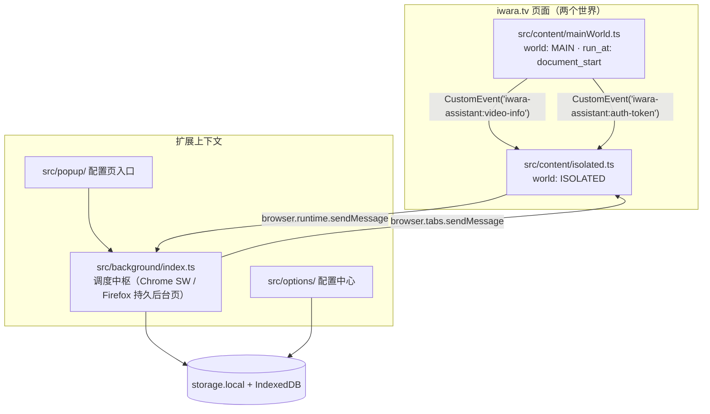

# 01 架构设计

## 设计原则

六条原则决定了后文的每一个取舍。先读这一节，后面那些「为什么不这样做」才有依据。

1. **能用平台能力就不自造**：后台单例替代跨页锁；`browser.alarms` 替代轮询；`downloads.onChanged` 驱动任务状态；配置与队列放在扩展自有页面。自造一层就多一份只能在开发机上验证的代码。
2. **唯一的不可替代品是页面主世界的 `fetch` 劫持**（改写站点看到的 `/videos` 响应体）。Chrome / Firefox 均无等价的扩展 API，所以以 `content_scripts[].world: "MAIN"` 原生声明保留，其余功能一律不碰页面。
3. **`browser.*` 一码两浏览器**：按 Chrome 官方 browser-namespace 指南统一写 `browser`，用 1 行运行时 shim 兼容 Chrome 111+ 与 Firefox，不引入 polyfill（见 [02](02-cross-browser.md)）。
4. **消息层全兼容**：`onMessage` 统一 `return true + sendResponse`，避开 Chrome 148 之前不支持 promise 型监听器的差异（见 [04](04-messaging.md)）。
5. **注入最小化**：iwara 页面上常驻的只有三段脚本（主世界劫持 + 隔离世界桥接 + 一个页面 UI），CSS 声明式注入、不自造样式表注入器；状态反馈走 `browser.notifications`，进度、队列与配置全在扩展页，页面里不建任何有状态视图。
6. **分段注入**：MAIN 只放「不改不行」的部分；ISOLATED 拆成「先桥接、后 UI」两段，握手不被 UI 体积拖慢。

## 运行时上下文

扩展按运行时边界拆分：页面两个世界（MAIN / ISOLATED）、后台、options、popup。



### 职责矩阵

| 运行时            | 职责                                                                                                                                                                                                | 不负责                                                                    |
| ----------------- | --------------------------------------------------------------------------------------------------------------------------------------------------------------------------------------------------- | ------------------------------------------------------------------------- |
| MAIN 世界脚本     | ①`document_start` 劫持 `window.fetch`；②捕获 `/videos`、`/user/token`、`Authorization` 头；③下行改写 `/videos` 响应体                                                                               | 解析入库（交给后台）、锁、DOM、**任何 `window.*` 全局暴露**（见下节）     |
| ISOLATED 世界脚本 | DOM 注入（卡片按钮、选择条）、`document.cookie` 采集、双向消息桥                                                                                                                                    | 配置面板（在 options）、RPC（在后台）、锁、状态反馈（notifications 接管） |
| Background        | 下载调度总管：任务队列（唯一写者）、四通道下载（browser/aria2/iwaradl/others）、RPC、`alarms` 定时、`downloads.onChanged` 事件、aria2 WebSocket 保活、`contextMenus`、`notifications`、角标队列计数 | —                                                                         |
| Options           | 配置读写、数据迁移导入、任务队列可视化、好友审批、使用引导                                                                                                                                          | 与宿主 DOM 共存的竞态处理                                                 |
| Popup             | **只做配置页入口**：九项页签导航（与 options 共用 `shared/optionsTabs.ts`），点击复用已开的 options 标签页并落到对应 hash；不展示队列                                                               | 队列查看与操作（全部归 options 任务页签）                                 |

## 源码目录结构

目录本身是架构的一部分：**同一个东西只能在一个地方**。平铺一层的文件超过「能一眼扫完」的量时，必须先按职责归位，而不是继续加文件。

### `src/` 顶层

| 目录/文件     | 职责                                                    |
| ------------- | ------------------------------------------------------- |
| `background/` | 后台（见下）                                            |
| `content/`    | 页内脚本：两个世界 + 页内 UI（`page/` 下按控件分模块）  |
| `options/`    | 配置中心（React），`tabs/` 一页签一文件                 |
| `popup/`      | 只做配置页入口                                          |
| `messaging/`  | 消息协议（`protocol.ts` 是唯一事实源）与 hub            |
| `shared/`     | 四个上下文共用的**纯逻辑**                              |
| `offscreen/`  | Chrome 专用：剪贴板与保活心跳                           |
| `browser/`    | `browser`/`chrome` API 的 shim（esbuild `inject` 注入） |
| `types/`      | iwara 站点数据结构的 ambient 声明                       |

### `src/background/`：只有 `index.ts` 与五个领域目录

`index.ts` 是**装配层**——注册事件监听、启动恢复、消息路由。业务逻辑一律下沉到目录里。

| 目录        | 装什么                                         | 典型文件                                                                                                                              |
| ----------- | ---------------------------------------------- | ------------------------------------------------------------------------------------------------------------------------------------- |
| `storage/`  | 本地状态的唯一真源                             | `configStore`（配置）、`queue`（队列唯一写者）、`db`（IndexedDB）、`parse`、`cacheList`                                               |
| `iwara/`    | 与站点交互（都要网络或身份）                   | `auth`、`videoApi`、`comments`、`interactions`、`playlists`、`friendApprove`、`promoteAuthor`、`linkCheck`、`pageSync`、`mediaCenter` |
| `download/` | 下载编排：把视频变成任务、把任务交给后端       | `dispatch`、`downloaders`、`downloadPath`、`adopt`、`cancel`、`batch`、`cardMeta`、`envCheck`                                         |
| `backends/` | 每个下载后端的连接与对账，**一个后端一个目录** | `aria2/{client,ws,tracker,recover}`、`iwaradl/{client,tracker}`                                                                       |
| `runtime/`  | 宿主平台能力（横切）                           | `alarms`、`notify`、`clipboard`、`contextMenus`、`keepAlive`、`guardRules`                                                            |

**后端目录必须同名**：同一角色的文件在不同后端目录里叫同一个名字（`client` = 连接与指令门面，`tracker` = 对账，`recover` = 恢复）。

**消息路由只做派发**：`index.ts` 的 switch 每个分支一行，实现体都在领域目录（例如
`REMOVE_TASK` → `download/queueActions.ts`，`LEGACY_DB_*` → `storage/legacyImport.ts`）。
如果某个 `case` 里出现了超过两行的逻辑，它就是该搬走的信号——否则装配层会慢慢长出业务规则。

**归位判据**（新文件该放哪）：

1. 它是某个后端的连接/对账？→ `backends/<后端>/`（不要新建 `trackers/`——后端本体与它的追踪器必须同居）
2. 它只读写本地状态？→ `storage/`
3. 它会发网络请求或解读站点数据？→ `iwara/`
4. 它在决定「下不下、怎么下」？→ `download/`
5. 它封装浏览器 API？→ `runtime/`
6. 以上都不是 → 先怀疑它不该存在（转发层、只换名字的包装都属于这一类）

**依赖方向**：`storage/` 是底座，不引用其它领域；`runtime/notify` 是横切能力，允许被任何领域引用。除此之外领域之间不互相 import——需要共享的判据抽到 `src/shared/`。

### `src/content/`：顶层只有 manifest 入口

```
content/
  guard/            钓鱼防护（一个功能的三段：MAIN 封锁 / ISOLATED 警告 / 跨世界契约）
    main.ts         → content/guard-main.js（MAIN world）
    isolated.ts     → content/guard.js（ISOLATED）
    protocol.ts     单向事件名与宿主 id（两边共用，不产出文件）
  page/             页内 UI 的模块（选择态 / 角标 / 菜单 / 水印 / 对话框 / 请求 / 配置）
  css/              页内样式，index.css 用 @import 汇总
  mainWorld.ts      → content/main-world.js（MAIN：fetch 劫持与改写）
  isolated.ts       → content/isolated.js（ISOLATED：MAIN⇄后台 桥接）
  pageUi.ts         → content/page-ui.js（ISOLATED：页内 UI 的启动与路由）
  markers.ts        三个入口共用的时序标记（非入口）
```

判据：**同一功能多个世界的脚本放一个目录**（`guard/`），目录名就是功能名；
顶层文件名就是 manifest 里的入口角色。`pageUi.ts` 自己就是副作用入口（末尾 `start()`），
不要再套一层 `pageUiEntry.ts` 转发文件——那是多出来的一个文件，零信息增量。

> `content/isolated.ts` 与 `content/guard/isolated.ts` 同名不同事：前者是整个页面的桥接，
> 后者只是钓鱼警告层。看 import 路径区分。

### `src/shared/` 为什么平铺

它是**叶子工具库**：30 个文件里只有少量互相引用（`analyzePath → i18n`、`migrationStream → legacyDb` 之类），没有任何服务依赖网络。文件名即用途（`task` / `url` / `paging`），再套一层目录反而让「这个纯函数在哪」需要先猜目录。

判据：**有内部依赖网络的服务模块要按领域分目录；彼此独立的叶子工具平铺**。

### `test/`：与源文件同名

30 个测试全部平铺且**文件名与被测模块一致**（`shared/task.ts` → `test/task.test.ts`）。
这一层不需要按 `src/` 的五个领域再分一层目录：找测试的唯一途径是「我知道要看哪个模块」，
而同名文件比路径更快。合并后的测试文件内部用 `── 某主题 ──` 分节（例如 `task.test.ts` 的
通道能力 / 重启对账 / 取消策略三节）。

### `e2e/`：两套体系并列

```
e2e/
  playwright/       Playwright（只跑 Chromium，直载 dist/chrome）
    specs/          10 个 spec
    helpers/        fixtures（launchPersistentContext + SW console 捕获）、site（读站点快照 + 回放 API 录制）
    fixtures/       iwara-list.html（真实站点结构快照）、api/*.json（真实 API 响应）
                    两者都由 capture.ts 本地刷新（headed Chrome 过 Cloudflare），CI 不跑
  wdio/             WebdriverIO（Chrome + Firefox 同一份用例）
    extension.spec.ts   常规套件（同一 session 顺序验收）
    live/               真实站点 / 真实 aria2（E2E_LIVE=1 才收集）
    manual/             手动验收（E2E_MANUAL=1，无断言，装好等人）
    helpers/            装载、后台活性、站点操作、手动模式
  types/            两套共用的页面上下文全局声明（browser / chrome）
  firefox-smoke.mts web-ext 冒烟（Playwright 不支持 FF 扩展直载）
```

**两套并列而不合并**：它们的能力边界不同——Playwright 能硬断言 SW console，但不能装 Firefox 扩展；
WDIO 能双宿主同构，但拿不到 SW console。合并“一套跑两边”会同时丢掉两边的优势。

⚠️ **`wdio/extension.spec.ts` 故意不拆成多个文件**：WDIO 每个 spec 文件会重建 session（重装扩展 +
重启浏览器），而 25 个用例共享同一个已加载的扩展与同一份 storage 演进（空队列 → 建任务 → 清队列）。
拆文件会让耗时从 ~18 秒变成几分钟，而用例间的顺序依赖（撤销权限用例必须最后跑）也会变得不可见。
这是「同一 session 的连续验收流程」，不是「该拆没拆」。

### `build/`：一脚本一职责

`index.ts` 是主流程（入口清单 + manifest 写入 + 静态资产），其余七个各管一件事：
`icons.ts` / `iconRenderer.ts`（图标栅格化，resvg）、`manifestV2.ts`（Firefox 形状改写）、
`package.ts`（ZIP）、`version.ts`（版本校验）、`env.ts`（带环境变量跑命令）、`crc32.ts`。

## 注入时机与安全

### 时机：`document_start` 已经是地板，不需要再造「更早的桩」

`run_at: "document_start"` 的平台定义就是**在任何 DOM 被构建、任何页面脚本被执行之前注入**（[Chrome 文档](https://developer.chrome.com/docs/extensions/develop/concepts/content-scripts#run_time)、MDN 同表述）。因此：

- `content/main-world.js` 的**第一行代码就已抢在页面所有脚本之前**；平台注入顺序不依赖 bundle 体积（同一时刻注入、按声明顺序执行）。
- 不为追求「更早」拆早期桩：`document_start` 已是平台能提供的最早时机，额外早跑桩没有收益，且会扩大攻击面。

当前注入顺序（均在 `document_start`，manifest `content_scripts` 顺序即执行顺序）：

| 段  | 产物                    | 世界     | 作用域       | 为什么在这个位置                                                                                                                                                                  |
| --- | ----------------------- | -------- | ------------ | --------------------------------------------------------------------------------------------------------------------------------------------------------------------------------- |
| 0   | `content/guard-main.js` | MAIN     | `<all_urls>` | 仿冒域名上把 `fetch` / `XHR.open` / `WebSocket` / `EventSource` / `sendBeacon` / 表单 `submit` / `RTCPeerConnection` 换成抛错桩；补网络层规则下发前的窗口期与 DNR 管不到的 WebRTC |
| 0   | `content/guard.js`      | ISOLATED | `<all_urls>` | 请求后台裁决（网络层封锁在后台下发），在 closed shadow root 里渲染全屏警告；官方域名下零 DOM                                                                                      |
| 1   | `content/main-world.js` | MAIN     | iwara.tv     | 唯一不可替代品；MAIN 先跑，其 `postUp()` 有 backlog，ISOLATED 迟到也能补发                                                                                                        |
| 2   | `content/isolated.js`   | ISOLATED | iwara.tv     | 只做桥接，体量小，握手最快                                                                                                                                                        |
| 3   | `content/page-ui.js`    | ISOLATED | iwara.tv     | ~26KB，最重，排最后不阻塞握手脚本                                                                                                                                                 |
| —   | `content/page-ui.css`   | 页面样式 | iwara.tv     | 声明式注入（挂在第 3 条的 `css` 上）；CSS 先于同条目的 JS 应用                                                                                                                    |

> 钓鱼防护的两条虽与 iwara 三条作用域不重叠（前者 `<all_urls>` 且在官方域名下零 DOM），仍固定排在最前：防护的语义就是「早于任何业务代码」，这条顺序不能因为“反正不冲突”而变。

> **样式不走 JS**。样式由 `content_scripts[].css` 在**浏览器层面**注入（`document_start` 期间、DOM 构建前），`page-ui.js` 里没有任何样式注入代码。beautify / widescreen 使用「常驻规则 + `html.ia-*` 类作用域」，开关只切类，无运行时注入。

时机证据（不是「看起来挺早」，而是可断言的事实）：

- `html[data-ia-hook]` —— MAIN 写入，真实站点实测 `readyState=loading;body=0;elements=0`
- `html[data-ia-early]` —— ISOLATED 写入，实测 `body=0;head=0;elements=0`
- 两者由 `e2e/wdio/live/site.spec.ts` 在真实站点守护

### 安全：MAIN world 里不存在秘密

需求本身（改写站点可见的响应体）就要求在页面雷亚运行，因此**必须接受下面三条硬限制**，而不是尝试对抗：

1. **钩子可被检测**：`window.fetch` 被包装后可被 `fetch.toString()` / 行为差异识别。所有主流管理器（Tampermonkey、ScriptCat）同样暴露，无解。
2. **钩子可被绕过**：页面重新赋值 `window.fetch` 即可。因此**任何安全判定都不能依赖钩子生效**。
3. **不能有控制入口**：曾把 `{ nativeFetch, queue, install }` 挂在 `window.__iwaraAssistantFetchHook`，等价于把「换掉我们的 handler」的能力交给页面——任何脚本在接管后调 `install(evil)` 即 MITM 全站请求；且 `queue` 暂存了含 `Authorization` 的 `init`。**已全部删除**，真实站点用例现反向断言 `window` 上不得出现 `__iwara*`/`__ia*` 全局。

配套规范：

- **跨越世界只传 `CustomEvent` + JSON 字符串**（`MAIN_CHANNEL`），不传任何对象引用、不共用全局。
- **主世界不持有不该给页面看的数据**：数据到手即经事件上行，不在页内缓存。
- **业务判定归后台**：队列去重、权限、落库均在 background，不信任页面世界任何声称（页面本来就可以伪造 `CustomEvent`）。
- **标记属性只能含非敏感量**：`data-ia-hook` / `data-ia-early` / `data-ia-bridge` 只写文档时序（`readyState`/`body`/`elements`）与握手状态，严禁版本号、扩展 ID、用户 ID、token。
- **`skipGlobalsShim`**：MAIN 入口构建时必须开启，否则 browser shim 会向页面写入 `window.browser = window.chrome`。
- **无 `web_accessible_resources`**：`content/main-world.js` 由声明式 `world: "MAIN"` 注入，不需要页面可加载；WAR 会让页面能 `fetch(runtime.getURL(...))` 拿走源码。

**已知保留项（有意接受）**：`/user/token` 响应里的 refresh token 会写入页面 `localStorage`（跨页面共享会话需要）。页面本来就能读自己的 `localStorage`，故不增加信任面，但也意味着无法承诺「token 不落到页面」——已写入 [PRIVACY.md](../PRIVACY.md) 与 README。

## UI 技术栈分野：React（扩展页）与命令式（页面注入）

**两条 UI 路线按运行时边界划分，不搞全局统一**：

| 区域                         | 技术                                               | 理由                                                                                                                                                                                                                                 |
| ---------------------------- | -------------------------------------------------- | ------------------------------------------------------------------------------------------------------------------------------------------------------------------------------------------------------------------------------------ |
| options / popup              | **React 19**（`jsx: automatic`，esbuild 原生支持） | App 型 UI：表单状态多、状态源是后台推送（`DOWNLOAD_STATE` / `storage.onChanged` → `useSyncExternalStore` 订阅）；不随页面导航注入，React 体积无成本；配置校验复用 `shared/configSchema`（+zod）；React 产品构建无 eval，MV3 CSP 无碍 |
| 页面注入（卡片按钮、选择条） | **命令式 `renderNode`**                            | 控件本质是「事件转发器」，无可 reconcile 的应用状态；React+ReactDOM ≈45KB gz 每次导航注入不划算；iwara 本身是 React 站点，页面里再挂 React 树徒增节点归属心智负担；ISOLATED 世界与站点隔离后也无需宿主节点防御性备份                 |

**页面内组件复杂度上限（设计红线）**：注入元素只允许两类轻量控件——可点击的下载/操作按钮、卡片勾选/选择条。**一切状态反馈（成功/失败/入队提示）统一走 `browser.notifications` 系统通知**；**进度列表、任务队列、历史记录、错误详情等一切有状态展示一律不进页面**，由扩展自有页面呈现（options 任务面板）——这些数据的家本来就在后台，展示层放扩展页零拷贝成本，也不用对抗站点样式与 DOM 变更。因此**不存在"页内组件升级到 React/Preact"的路径**：未来某个交互确实复杂时，正确动作是往 options/notifications 加功能，而不是把组件搬进页面。页面注入样式沿用独立命名空间隔离站点 CSS（见 [05-features.md](05-features.md)）。

**扩展页的 toast 不自研**：options 侧用 `sonner`——保存反馈、队列操作、迁移导出都是"通知"，本质是队列而非单值（旧的全局字符串会被后到的覆盖）；错误文本需要可关闭、可停留阅读；aria-live / 键盘可达 / reduced-motion 由库提供。页面只挂一个 `<Toaster>`（`src/options/toaster.tsx`，仅配置主题/位置/a11y），业务代码直接调用 `toast`，不再套一层命名包装函数。它只进 options bundle（该入口本来就有 React），**content script 不引入任何 React/UI 库**——两条路线互不越界。

**配置导入导出与设置入口只在扩展页**：options「迁移」页签负责导入导出，工具栏 popup 负责页签入口；页内菜单只保留高频的下载与选择动作，避免在页面里重复一遍校验/合并逻辑。

**迁移页必须支持粘贴，而不只是选文件**：旧版脚本的「导出配置」只产生剪贴板里的**裸配置 JSON**，不产生文件。因此迁移页的主入口是「粘贴框 + 导入粘贴内容」，文件选择只是同一管线的另一个输入源。两种来源的形态不同：旧脚本剪贴板里是**裸配置对象**，本扩展导出的是**完整迁移包** `{config, videos, follows, friends, idmap}`；`shared/migrationStream.ts` 按「有 config/四表键 → 包；否则含已知配置键 → 裸配置；都不是 → 报错」识别（形态与类型定义在 `shared/migrationPayload.ts`）。第三分支是安全阀：若不报错而按空配置处理，zod 会用默认值覆盖用户配置。

**整份载荷不得序列化成一个字符串（导出/导入的铁律）**：V8 的单字符串上限是 2^29−24 字符（≈512 MiB），而视频库单条记录可达数 MB——`JSON.stringify(整个载荷)` 会直接抛 `allocation size overflow`，`file.text()` 在导入端会撞同一个上限（"自己导出的备份自己导不回来"）。因此两端都必须增量：

- 导出：`options/exportBundle.ts` 按 `DB_EXPORT_PAGE` 一页页读、一条条序列化，攒够 1 Mi 字符就产出一块，每块立刻转成 `Blob`（原字符串随即回收），最后 `new Blob(parts)`。产出格式与 `JSON.stringify(payload, null, 2)` **逐字节一致**（e2e 有契约用例）。**必须报进度**：几万条 / GB 级的库要跑几分钟，期间界面上不能只有一颗变灰的按钮。总量由 `DB_STORE_COUNTS` 预取（`count()` 只扫索引，不反序列化记录），进度因此是**确定态**而非装样子；每页一次 React 更新，页间的消息往返本来就会让出事件循环，所以进度条能真的动。
- 导入：`shared/migrationStream.ts` 是**字符级流式扫描器**（块内同步推进、只在块边界 `await`），把 config、未知键与四表**逐条**切出来各自 `JSON.parse`；文件侧用 `file.stream().pipeThrough(new TextDecoderStream())`，**禁止 `file.text()`**。记录边解析边攒批，超过 `LEGACY_MAX_MESSAGE_*` 就立刻发 `LEGACY_DB_BATCH`，峰值内存恒定。
- 剪贴板是唯一无法流式的目标（`writeText` 只收一个字符串），所以有显式上限并在超限时明确告知改用文件导出；裸配置对象也一样（它只有几十 KB，超过 8 Mi 字符就判为「无法识别」）。

**跨 origin 数据只能经 content script**：旧油猴脚本的视频库/关注/好友/ID 映射写在 `iwara.tv` 页面 origin 的 IndexedDB（`IwaraDownloadTool`），扩展自己的库在 `chrome-extension://<id>` origin——**后台 SW 物理上看不到页面 IDB**。因此旧库迁移的数据路径是：content script（页面 origin）按键区间分页读（**不允许 `getAll()` 整表**：老库可能有几十万条、单条简介可达数 MB）→ 按 16 MiB / 1000 条装批 `LEGACY_DB_BATCH` 回传 → 后台 sanitize 逐条校验后写自己的库。检测在首次进 iwara 页自动做（只读计数，`indexedDB.databases()` 先探测存在性，避免 `open()` 凭空建库），**导入必须由用户在迁移页显式触发**：自动导入会在用户删数据后把旧记录复活；且旧脚本的配置存在 GM 私有存储，页面读不到，只能走粘贴/文件导入（旧脚本「导出配置」= 剪贴板里的裸配置 JSON）。

**体积上限按"事务"而不是"记录"计**：Firefox（`dom/indexedDB`）在单次写事务/响应超过约 246 MiB 时直接抛 `The serialized value is too large`，而消息通道并没有这个数（1.8 GB 的消息能发出去，写库时才炸）。所以批量写入必须切成**小到不会撞上限、又大到不浪费往返**的事务：`bulkPutIsolated` 按 32 MiB / 500 条一节、每节独立事务；某节失败就**二分到单条**，把坏记录计成 `failed` 并让其余数据继续落库——旧实现把整批塞进一个事务，一条超大记录就能让整次迁移失败且报错指向体积而非那条记录。两套预算常量都在 `src/shared/legacyDb.ts`（消息侧 `LEGACY_MAX_MESSAGE_*`、写库侧 `LEGACY_MAX_WRITE_*`），页面侧与后台侧共用同一份，避免两边各写一套魔数。导入结果必须**如实计数**：`written / invalid（结构不合规）/ failed（读不出来或写不进）`，UI 上分别提示，不许用"导入成功"盖掉丢数据。

## 注入最小化原则

目标：**非交互状态下页面零 DOM 注入，常驻 JS 只有"两个薄壳"**。

| 注入物            | 形态                                         | 说明                                                                                                                                                                                                                                                                |
| ----------------- | -------------------------------------------- | ------------------------------------------------------------------------------------------------------------------------------------------------------------------------------------------------------------------------------------------------------------------- |
| MAIN 世界纯转发器 | JS（常驻，最小化）                           | 仅两件事：①`fetch` 劫持；②对 `/videos` 响应做**纯函数改写**（点赞/私有过滤用响应自带字段；"缓存回填"按本页窗口经 `GET_CACHE_INJECTION` 取后台预计算列表，**不在页面查库**——解析、入库、字段展开全部在后台，MAIN 不引入 idb/parse 依赖）                             |
| ISOLATED 薄桥     | JS（常驻，最小化）                           | CustomEvent⇄runtime 消息桥 + `document.cookie` 采集 + 按需按钮渲染器，无业务逻辑                                                                                                                                                                                    |
| 声明式 CSS        | `content_scripts[].css`（manifest 静态文件） | beautify / widescreen / 自定义皮肤由浏览器在导航时自动应用，不占 JS、无执行时机问题                                                                                                                                                                                 |
| 按需 DOM          | 选择模式激活 / `enableCardButtons` 开启时    | 批量选择工具条 + 卡片按钮；正常浏览默认 0 个注入节点                                                                                                                                                                                                                |
| 引导体验          | `runtime.onInstalled`（安装/更新事件）       | options 内置「使用引导」页签（安装引导 + host 权限检测 + 钓鱼防护说明），`runtime.onInstalled(reason)`：`install` / `update` 都打开引导页（`install` 时聚焦）——页面零注入零打扰。**不内置更新日志**：发布说明留在商店页与 release notes，避免每版都要在代码里补一份 |

交互动手的另一个主入口是 **`contextMenus`**（视频链接 / 视频页右键「下载此视频」）——平台原生 UI，零注入成本。

## Background 双宿主同一 bundle

- 构建产物为**单文件 IIFE**（`background.js`），无顶层 ES module 依赖 split。
- Chrome：`manifest.background.service_worker = "background.js"`（MV3）。
- Firefox：**MV2**，`background.scripts = ["background.js"]` + `persistent: true`（持久后台页）。MV2 不是怀旧——它是 Firefox 上唯一能直连局域网明文 http 的形态（LNA 只拦 MV3，见 [02-cross-browser.md](02-cross-browser.md)），顺带消掉事件页挂起的整类问题；同一份 IIFE bundle 两端通用。
- 代码内仍禁用「常驻内存」假设：**Chrome SW 空闲 ~30s 就被回收**；MV2 的持久后台页只是「当前产物没用上挂起机制」，并不是规范承诺。状态一律先落 `storage.local` / IndexedDB；入内存的仅是运行中任务缓存 + 事件重入。这条纪律是 Chrome 侧能正常工作的前提，不能因为 Firefox 常驻就放松。

**挂起协议（必须遵守）**：

1. 任何队列状态变更先持久化 → 再处理；
2. 长任务全部由事件唤醒（消息、`downloads.onChanged`、WebSocket 帧、alarm），绝不 `while+sleep`；
3. Chrome 侧 aria2 WebSocket 通道维持 SW 存活（116+ 收到 WS 帧即重置 30s 计时）；Firefox 持久后台页无此问题；
4. WS 断线由 alarm 兜底重连（指数退避）。

**保活（Chrome，默认关闭）**：用户可在「高级 → 扩展行为」打开 `keepBackgroundAlive`。实现见 `src/background/runtime/keepAlive.ts`：offscreen 文档每 20 秒向 SW 发一次端口消息。收益只有一件事——WS 通知不必等 `scan-aria2`（5 min）兜底；代价是 SW 不再被空闲回收。**它不是官方能力**，Chrome 文档明确要求「避免无限期保活」，所以默认关闭、失败静默退回 alarms。Firefox 侧该开关无效（持久后台页本就不挂起）。

## 定时任务清单（`browser.alarms`）

| alarm          | 周期                  | 动作                   |
| -------------- | --------------------- | ---------------------- |
| `scan-aria2`   | 5 min                 | 全量扫 aria2 任务入队  |
| `ws-keepalive` | 2 min                 | WebSocket 探活重连     |
| `retry-failed` | 可配置（默认 30 min） | 扫描失败任务按策略重试 |
| `refresh-sync` | 可配置                | 按标签页广播扫描指令   |

## 状态与数据

- **配置**：`storage.local`（含自定义 RPC 端点、下载模式、路径模板）；跨标签页即时生效靠 content 动作前读缓存（低频）+ `storage.onChanged` 失效广播（后台发出）。
- **视频库**：IndexedDB（**后台专属**）。任何上下文需要读写都经消息：`GET_VIDEOS`（查询）/ `DB_EXPORT_PAGE`（全量导出分页）/ `LEGACY_DB_BATCH`（批量写入）。options 与后台虽同为扩展 origin、物理上能直接 `openDB`，但**分层上禁止**——两个写入者会让事务语义与错误归属都无法界定。
- **任务队列**：`storage.local` 持久化 + 后台内存运行副本；启动时从 storage 恢复。旧版数据迁移：options 提供导入向导，读取旧脚本页面数据库或粘贴配置（见 [05-features.md](05-features.md#数据与迁移)）。

## 权限与页面能力的边界

Chrome 平台约束（已核验）：

- `webRequest` MV3 只读且**永不暴露响应体**，`declarativeNetRequest` 不改 body——故响应体改写必须留页内注入（详见 [05-features.md](05-features.md)）。
- `chrome.debugger`（CDP）虽能改 body，但常驻挂调试器带横幅/权限警告/DevTools 互斥，**显式不采用**。
- Authorization 头捕获：现 MAIN 劫持已覆盖（请求发出前 init.headers），无需 `webRequest`。

### 权限模型：一次声明全站

`host_permissions: <all_urls>`，无 `optional_host_permissions`。理由与取舍见 [03-manifest.md](03-manifest.md#全站-host-权限一次声明两处用途)；关键结论：`permissions.request()` 只对 optional 权限有效，required 权限无法在运行时补授——所以引导页只做诊断，不提供按钮。

### 钓鱼仿冒防护

钓鱼仿冒防护需要全屏警告与网络封锁；页面 JS 层只是最里面那层。

**三层防线（页面 JS 层只是最里面那层）**

| 文件                                              | 世界     | 职责                                                                                                                                                                                                                                 |
| ------------------------------------------------- | -------- | ------------------------------------------------------------------------------------------------------------------------------------------------------------------------------------------------------------------------------------ |
| `background/runtime/guardRules.ts`                | 后台     | **主防线**：按 `sender.tab.id` 给该标签页下一条 DNR session 规则，拦住除顶层导航外的**一切**请求（img / font / 表单 / beacon / 跨域 iframe / Worker / 媒体）。页面脚本无法解除                                                       |
| `content/guard/main.ts` → `content/guard-main.js` | MAIN     | 页面 JS 层（`document_start` 同步）：替换 `fetch` / `XHR.open` / `WebSocket` / `EventSource` / `sendBeacon` / 表单 `submit` / `RTCPeerConnection`；覆盖网络层规则下发前的窗口期，以及 DNR 结构上管不到的 WebRTC（`skipGlobalsShim`） |
| `content/guard/isolated.ts` → `content/guard.js`  | ISOLATED | 渲染全屏警告；发 `GUARD_SYNC` 让后台裁决，点「继续访问」时发 `GUARD_RELEASE`（真实点击，页面伪造不了）                                                                                                                               |
| `shared/site.ts`                                  | 共用     | `OFFICIAL_DOMAINS` / `PHISHING_KEYWORDS` / `classifyHost()`                                                                                                                                                                          |

**为什么不是一个脚本**：封网络必须在 MAIN 世界（页面自己的 `fetch` 才可被替换），而可信 UI 必须在 ISOLATED（页面脚本读不到 closed shadow root 里的按钮）。两者只能靠一个**单向事件名**通信（`content/guard/protocol.ts`）。关键区分：这个事件**可被页面伪造**，所以它只恢复页面级 API、绝不解除网络层；`GUARD_RELEASE` 只能由 ISOLATED 里的真实点击发出。e2e 直接守这条：页面自己派发 continue 事件后，请求依旧出不去。

**为什么网络层用「按标签页」的 session 规则**：判据是「主机名包含品牌词」（仿冒站域名每天在换），DNR 的 `requestDomains` / `urlFilter` 表达不了这种模式；而 `tabIds` 能把**发起方各异**的请求一网打尽（跨域 iframe、Worker 的 initiator 各不相同，按域名匹配必然漏）。session 语义正好：规则随浏览器退出清空，不会把封锁状态留到下次启动。

**状态机（每个标签页最多一条规则，id = tabId，规则即状态）**

| 状态       | 含义                         | 规则           | `storage.session`   |
| ---------- | ---------------------------- | -------------- | ------------------- |
| `none`     | 官方站 / 无关站 / 无记录     | 无             | 无                  |
| `armed`    | 疑似仿冒，正在拦             | 有（id=tabId） | 无                  |
| `released` | 用户已明确选择继续，不再打扰 | 无             | `{ [tabId]: host }` |

- **判定与状态都在后台**：页面（含 ISOLATED）只能上报「我是哪个主机名」，后台用 `classifyHost` 复核，标签页身份取 `sender.tab.id`（页面伪造不了）。
- **放行记录必须跨 SW 回收**：Chrome SW 空闲 ~30s 就回收，只放内存会让「继续访问」活过 30 秒就失效。用 `storage.session` 而不是 `local`：tabId 跨会话会重用，昨天的 tab 5 不能影响今天的新 tab 5。
- **清理是安全的一部分**：规则按 tabId 匹配，标签页离开仿冒站后若不撤规则，该标签页后续的正常浏览会被一条看不见的规则毁掉。所以 `tabs.onUpdated`（换了文档且不再可疑）与 `tabs.onRemoved` 都撤；`boot()` 里的 `reconcileGuardRules()` 再扫一遍残留（SW 回收期间规则留在内核里，标签页可能早就关了）。
- **降级**：拿不到 `declarativeNetRequest` 或规则下发失败时只 `console.warn`，页面 JS 层继续拦 fetch/XHR/WS/表单/WebRTC——不能因为网络层不可用就把整个警告关掉。

**判定规则（`classifyHost`）**：主机名小写、去尾点后，按**完整标签后缀**匹配官方域（`iwara.tv` / `iwara.zip` / `iwara.shop` / `iwara.ai`）——所以 `iwara.tv.evil.com` 是仿冒而不是官方；之后看是否含品牌词（`iwara`），含则 `suspicious`，否则 `other`（no-op）。单测 `test/site.test.ts` 固定这三层。

**防拆除**：警告宿主在 **closed shadow root** 里渲染（页面既改不了样式，也拿不到内部节点，避免「改个 CSS 就把警告藏了」）；`MutationObserver` 在宿主被移除时补种。官方域名下**零 DOM、零全局写入**（页面上不能出现任何可探测痕迹）。

## 技术底座

| 层         | 选型                                                              | 为什么是它                                                                                                                         |
| ---------- | ----------------------------------------------------------------- | ---------------------------------------------------------------------------------------------------------------------------------- |
| 构建       | esbuild（IIFE 多入口 + React 19 `jsx: automatic`）+ tsx 脚本      | 无运行时依赖、构建即产物；`inject` 把 `browser` shim 注入所有入口，入口文件不写一行样板                                            |
| 浏览器 API | `browser.*`（Chrome MV3 service worker / Firefox MV2 持久后台页） | 一套代码两宿主，差异全部收在 shim 与 manifest 派生里（见 [02](02-cross-browser.md) / [03](03-manifest.md)）                        |
| 配置校验   | zod                                                               | 缺省字段自动补默认值、脏数据回落默认；配置结构是唯一真源，UI 与后台共用                                                            |
| 本地存储   | `browser.storage`（配置/队列/会话态）+ IndexedDB（视频库，`idb`） | 视频库单条可达数 MB，不适合塞进 storage；队列要能被 `storage.onChanged` 驱动 UI 重渲染                                             |
| 国际化     | i18next + react-i18next                                           | 扩展页用 `useTranslation()`，非组件模块直接用 `i18n.t()`；键名由 `i18next.d.ts` 编译期校验（见 [05](05-features.md#配置与多语言)） |
| 扩展页 UI  | React 19 + sonner（toast）                                        | App 型表单与后台推送驱动的状态；页面注入侧仍为命令式，不引入 React（理由见上文「UI 技术栈分野」）                                  |
| 测试       | `node:test`、Playwright、WebdriverIO、`web-ext`                   | 分层与命令见 [06](06-testing-and-release.md)                                                                                       |
| 打包       | 手写 ZIP（node:zlib）                                             | 只需“把目录打成带正确路径分隔符的 zip”，不引入打包工具链                                                                           |
