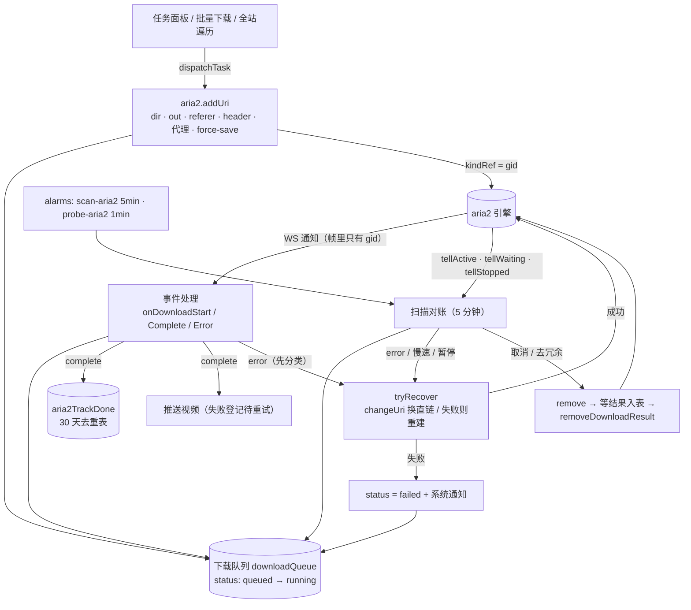
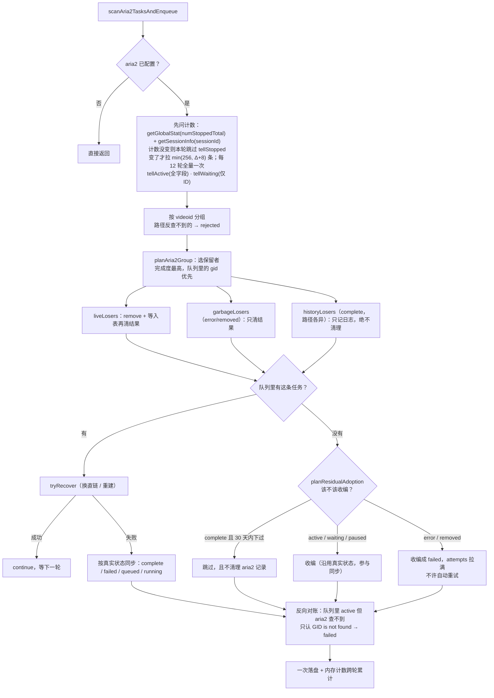
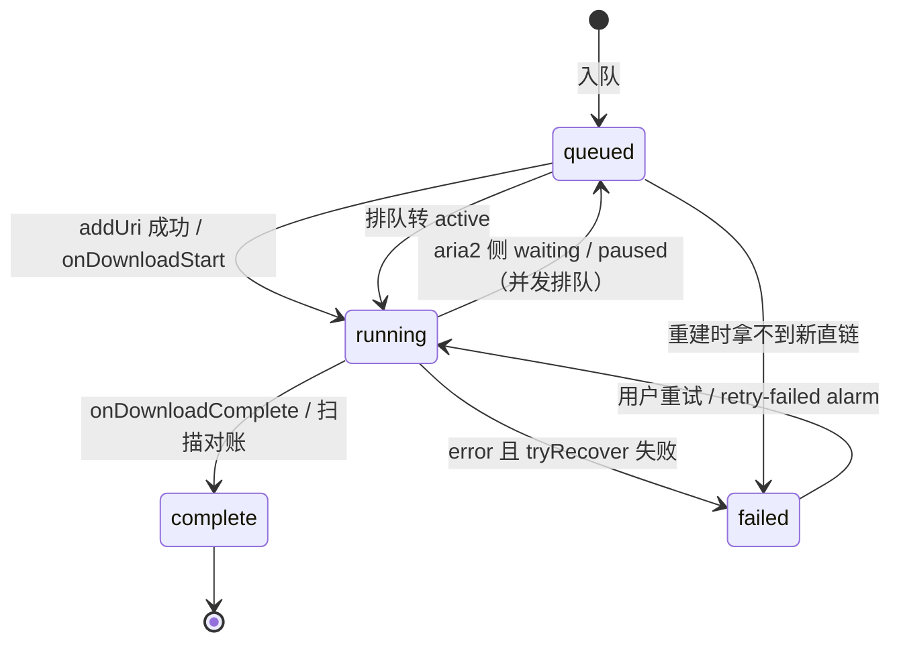
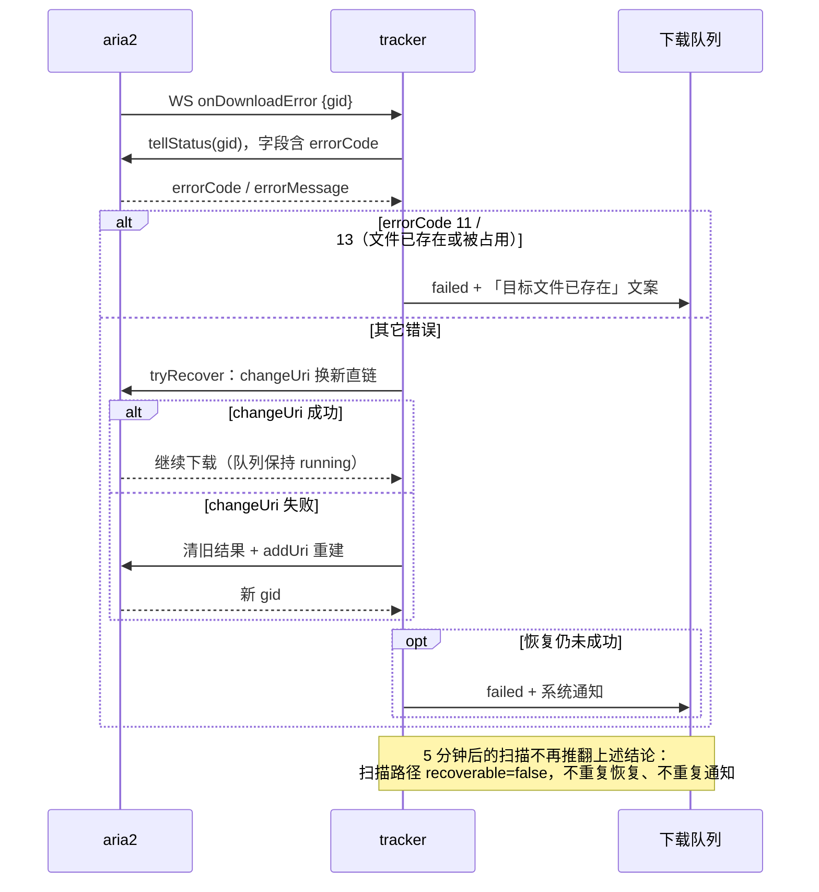
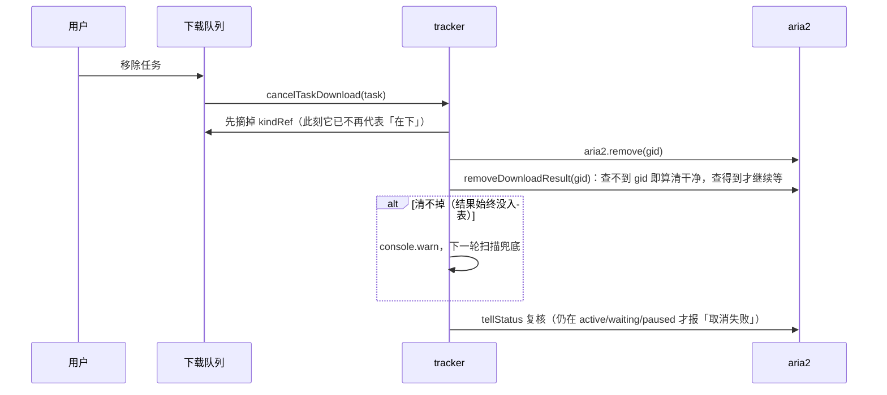

# 08 aria2 下载任务管理：逻辑图

> 本文画的是**当前代码的实际行为**（已含 P0-1 / P0-2 / P0-3 三条修复）。尚未实装的优化见 [aria2-optimization-proposal.md](aria2-optimization-proposal.md)，不要把那份当现状读。

aria2 这条通道只有**三个真相源**：`aria2` 引擎（实际在下什么）、`storage.local.downloadQueue`（界面看到的队列）、WS 通知（尽量及时，但会丢）。三者之间没有事务，全部靠下面的两条路径对齐。

## 1. 一图总览



## 2. 三条入口，职责互斥

| 入口                | 触发                     | 频率         | 唯一的职责                                     | **不**负责                         |
| ------------------- | ------------------------ | ------------ | ---------------------------------------------- | ---------------------------------- |
| 投递 `dispatchTask` | 用户点下载 / 批量 / 遍历 | 事件驱动     | 解析直链 → `addUri` → 写 `running` + `kindRef` | 之后到底下没下成                   |
| WS 事件             | aria2 主动推             | 实时（会丢） | 尽快把终态写回队列与去重表                     | 丢失补偿、断线重放（aria2 不重放） |
| 扫描对账            | `scan-aria2` alarm       | 5 分钟       | 把「aria2 里的真实状态」追平到队列             | 立即性（最长滞后 5 分钟）          |

这就是为什么「已完成的任务还显示下载中」这类现象通常等 5 分钟会自己好——但对账只补终态，**中途的错误要靠事件那一刻就分类**，否则会出现「先报失败、5 分钟后又自己恢复」。

## 3. 扫描对账内部流程



`tellWaiting` 是 P0-1 补上的一路：**`waiting` / `paused` 只在这张表里**（aria2 的并发排队），`tellActive` 看不到、`tellStopped` 也看不到。漏了它，`statusOfAria2` 的 waiting/paused 分支就是永远走不到的死代码，排队中的任务会一直显示「下载中」。

## 4. 状态映射

| aria2 状态          | 队列状态   | 说明                                             |
| ------------------- | ---------- | ------------------------------------------------ |
| （尚未 addUri）     | `queued`   | 只是排在我们自己的队列里                         |
| `active`            | `running`  | 真的在传                                         |
| `waiting`           | `queued`   | aria2 的并发排队，**不是**在下载                 |
| `paused`            | `queued`   | 暂停中；扫描会尝试 unpause（链接过期时先换直链） |
| `complete`          | `complete` | 写去重表 + 推送                                  |
| `error` / `removed` | `failed`   | 先分类（文件冲突单独文案），再尝试恢复           |



## 5. 一次失败的完整时序（P0-2 的修复点）



旧行为是「事件直接判 failed → 扫描又恢复 → 用户看到失败后又自己好了」。现在恢复发生在事件那一刻：链接过期是 iwara 直链的常态，等五分钟才自愈比不修更糟。

## 6. 取消路径（P0-3 的修复点）



先摘 `kindRef` 的原因是：`remove` 会触发事件，如果队列还指着这个 gid，刚被取消的任务会被当成一次失败、甚至触发一次恢复重建——用户点了取消，转头又冒出一条新任务。

`removeDownloadResult` 之所以要带回退判断：`remove` 只置 halt 位，结果要等下一个事件循环才进 `downloadResults_`；早先「remove 紧跟 removeDownloadResult + 空 catch」的写法会静默失败。真机实测（2026-11-18）还发现另一种情况：取消 **waiting** 任务时 gid 会彻底消失、根本不产生结果记录——所以「`GID ... is not found`」必须再问一次 `tellStatus` 才能区分「结果还没入表」与「已经清干净」。

## 7. 看到这些现象时，先别怀疑这条链路

| 现象                                | 真实原因                                            | 不是 bug 的证据                    |
| ----------------------------------- | --------------------------------------------------- | ---------------------------------- |
| 进度条不动，但 aria2 在下           | 浏览器通道拿不到字节进度；aria2 通道靠轮询快照      | 见 AGENTS.md「已知限制」           |
| 刚下完，队列还显示下载中            | WS 事件丢了，等 5 分钟对账                          | 扫描的 complete 分支               |
| 任务在 aria2 里排队，界面显示排队中 | `waiting` 映射成 `queued`                           | 本文第 4 节                        |
| 失败原因写着「未知错误码」          | 只有 aria2 没给 errorCode 时才这样（如被外部 kill） | `ARIA2_STATUS_FIELDS` 含 errorCode |

## 8. 分支兼容（上游 aria2 / aria2-next）

同一套 RPC 在三条实际行为线上并不等价，**只按版本号判断会踩坑**（`1.36.0` 与 `3.1.1` 是两条互不相干的版本线）。四次真机实测（2026-11-18 / 11-19 / 11-20）得到：

| 行为                                                         | 上游 1.36.0             | aria2-next 2.4.9 | aria2-next 3.1.1                                             |
| ------------------------------------------------------------ | ----------------------- | ---------------- | ------------------------------------------------------------ |
| `getVersion().product`                                       | 无                      | **无**           | `aria2-next`                                                 |
| `aria2.probe` / `aria2.moveDownload`                         | 无                      | 无               | **有**                                                       |
| 媒体任务（HLS/DASH）                                         | 不支持                  | 不支持           | 支持：`totalLength` 恒 0，进度在 `media.progress`            |
| 403 过期直链                                                 | `error 22`（5 秒内）    | `error 22`       | **永远 `active`、不报错**（每 10 秒重试）                    |
| `addUri` 选项（`force-save`/`referer`/`header`/`all-proxy`） | 全部接受                | 全部接受         | 全部接受                                                     |
| 取消后清结果                                                 | 1 次成功（35 ms）       | 1 次成功         | 1 次成功                                                     |
| 会话 ID 方法名                                               | `system.getSessionInfo` | 未测             | **`aria2.getSessionInfo`**（`system.*` 回 `No such method`） |

**2026-11-20 复查（两台测试机都已升级到 `aria2-next 3.1.1`）**：`getVersion` 回 `product: aria2-next` / `rpcVersion 1.1.0` / 55 个方法，`system.listMethods` 里有 `aria2.probe` / `moveDownload` / `resolveFilename` / `finishMedia` / `retryMedia`。上游 1.36 那台已不存在，表里它的行为是升级前的实测记录，保留作为兼容依据。

**同一台机器上 `system.getSessionInfo` 与 `aria2.getSessionInfo` 只有一个存在**：3.1.1 只认后者，上游只认前者。会话 ID 是「aria2 重启过没有」的唯一可靠信号（重启后旧 gid 全失效，慢速/停滞采样、恢复次数、网络退避都必须一起清），读不到就只能每轮拉全量 `tellStopped`。所以 `client.ts` 的 `aria2SessionId()` 两个名字都试，成功过就缓存命中项（`ARIA2_SESSION_INFO_METHODS`）。第二个信号是 `numStoppedTotal` **倒退**——它单调递增（被挤出/被删的条目也计入），只有重启会让它变小，`planStoppedWindow()` 因此把倒退也判成 `restarted`。

**这台升级后的 3.1.1 上，403 依旧表现为「不报错地卡住」**：抽查 `tellActive` 的 17 条里 16 条 `totalLength=0` / `downloadSpeed=0` / `connections=0`（`getGlobalStat.numActive` = 18），同时也有历史记录已落成 `errorCode 22 / HTTP 403`。所以判据不变：**不能等错误浮出**，靠停滞判定（`aria2StallSignature` 跨轮签名不变化 × 连续 2 次）主动 `changeUri` 换新直链；投递时加 `max-tries: 5` 只是让「永不报错」最多 5 轮后浮出。

### 怎么判断

判据在 `src/shared/aria2Flavor.ts` 的 `parseAria2Capabilities()`，**先看 `product`、再看 `enabledFeatures`**：2.4.9 没有 `product`，只能靠 `ED2K` 认出来。认不出来就按上游处理——把 aria2-next 当上游只是少用两个可选能力，反过来会让老版本行为莫名其妙地变。

`aria2Capabilities()`（`backends/aria2/client.ts`）负责取一次 `getVersion`；只有**自报身份**的 aria2-next 才再补一次 `system.listMethods`，用方法表校正 `probe`/`moveDownload`（版本线判断是启发式，方法表是事实）。结果缓存 10 分钟，`resetAria2Capabilities()` 可强制重探。

### 行为分叉点（就这三处）

| 能力位                   | 影响                                                                                                       | 位置                                               |
| ------------------------ | ---------------------------------------------------------------------------------------------------------- | -------------------------------------------------- |
| `media`                  | 扫描/探测的字段集追加 `media`；进度改读 `aria2ProgressOf()`（`totalLength` 为 0 时退回 `media.progress`）  | `tracker.ts` `progressFields()`、`syncLiveState()` |
| `stallsOnForbidden`      | 投递时给任务加 `max-tries: 5`，把永不出现的错误逼出来（实测 403 从「永不报错」变成 2 秒内 `errorCode 22`） | `downloaders.ts` `aria2AddUriParams()`             |
| `probe` / `moveDownload` | 目前**只探测不使用**：两项都依赖「投递前预检」与「改目录」的新流程，留给后续单独做                         | `client.ts`                                        |

**媒体任务的覆盖情况**：**慢速**判定仍不生效（`shouldRestartForSlowSpeed` 要求 `totalLength > 0`，而 HLS 任务恒为 0）；但**停滞**判定已覆盖（`aria2StallSignature` 在 `totalLength` 为 0 时改用 `media.progress`，P1-2 已实施），所以媒体任务卡住仍会被 `changeUri` 重启，只是「慢」不会被当成「停滞」。

### 配置自适应（问 `getGlobalOption`，不要假设）

同一个 `addUri` 参数在不同配置下含义不同，硬编码等于替用户改配置。实测两条硬结论：

| 参数                  | 实测语义                                                                                                                                                     | 我们的做法                                                                                                             |
| --------------------- | ------------------------------------------------------------------------------------------------------------------------------------------------------------ | ---------------------------------------------------------------------------------------------------------------------- |
| `all-proxy: ''`       | **不是「继承」，而是「强制不走代理」**：全局代理指向不通的地址时，不带该键的任务继承代理（一直 active），带空串的任务 `getOption` 里没有这个键且**直连成功** | 扩展里没配代理就**一个键都不给**（`aria2ProxyParams`），否则会静默废掉 `aria2.conf` 里的代理                           |
| `max-tries: 0`        | 「无限重试」。用户的 conf 与那台服务器都是 0                                                                                                                 | 只有当分支的 403 会卡死（`stallsOnForbidden`）**且**服务端 max-tries=0 时才补 `max-tries: 5`；用户自己设了上限就不覆盖 |
| `max-download-result` | 结果窗口上限，0 = 不限；决定 `tellStopped` 能拿到多少条                                                                                                      | 扫描按它取条数（再封顶 4096），不多要                                                                                  |

`aria2GlobalOptions()`（`backends/aria2/client.ts`）取一次 `getGlobalOption` 并缓存 10 分钟，与能力探测同生命周期（`resetAria2Capabilities()` 一并清掉）。判据本身是纯函数（`src/shared/aria2Options.ts`），单测覆盖。

## 9. 什么时候动一个「看起来还在跑」的任务

aria2 有两条完全不同的「卡住」，判据分开，不能混。

| 现象                 | 判据                                                                     | 出手                                 |
| -------------------- | ------------------------------------------------------------------------ | ------------------------------------ |
| **慢**：在动，但太慢 | `downloadSpeed <= 16 KB/s` 且连续 2 次采样；进度 ≥ 98% 且速度非 0 时豁免 | `restartAria2Task`（换地址，保进度） |
| **停滞**：完全不动   | `active` 且**进展签名**连续 2 次采样没变（采样间隔 ≥ 45 秒）             | 同上                                 |

停滞这条是给「aria2 根本不报错」准备的：aria2-next 3.1.x 上 403 会永远停在 `active`（`errorCode` 为空、每 10 秒重试一次），上游与 2.4.9 都会正常给 `errorCode 22`。除了「字节数不动」没有别的信号可用。

两个容易写错的地方：

1. **进展签名要包含媒体进度**。媒体任务的 `totalLength` 恒为 `0`（实测 3.1.1），只看 `completedLength` 会在分片合并期误判；签名是 `completedLength|aria2ProgressOf(status)`，后者对媒体任务取 `media.progress`。
2. **采样要隔够时间**。1 分钟的 probe 与 5 分钟的扫描是两条独立定时器，撞在一起时各记一笔会让「连续 2 次」同时代表 2 分钟和 10 分钟。所以：`nextStallSample` 拒绝间隔 < 45 秒的重复采样，慢速采样则**只由 probe 记账**（扫描只读）。

两条定时器各自加了单飞锁（`scanInFlight` / `probeInFlight`）：后到的调用等同一个 Promise。扫描一次要传 12 MB 的 `tellStopped`（1134 条历史），并发两份就是白烧 24 MB 流量，还会各自判「冗余」各删一遍结果。

## 10. 网络受限环境（DNS 污染 / 连接重置 / IP 阻断 / SNI 嗅探）

国内网络访问 iwara 的不稳定不是「偶发失败」，而是**成片、持续、无差别**的。这一节把我们能控制的与不能控制的分开，避免用「重试」掩盖真实原因。

### 两个失败域，处置相反

| 失败域                                          | 表现                                                                       | 重试/重解析有用吗                                                      | 我们的做法                                                       |
| ----------------------------------------------- | -------------------------------------------------------------------------- | ---------------------------------------------------------------------- | ---------------------------------------------------------------- |
| **我们自己的 iwara 请求**（解析视频页、拿直链） | `TypeError: Failed to fetch`、`NetworkError`、AbortError                   | 重试**有用**（抖动常见）；换 URL 没用                                  | 归为网络层，文案指向代理设置，不消耗「视频解析不了」的重试预算   |
| **aria2 的下载请求**                            | `errorCode 6/19/2/23`、`errorCode 1 + Connection reset`、`22 + status=5xx` | 重试**有用**；**重解析没用**（新链接同样连不上，而且解析本身也要出网） | 指数退避（1 分钟起、封顶 30 分钟），**不重解析**；成片失败时熔断 |

判据在 `src/shared/aria2Network.ts`（纯函数，单测钉住）：

| 归因            | 触发                                                                    | 后果                                         |
| --------------- | ----------------------------------------------------------------------- | -------------------------------------------- |
| `expired`       | `errorCode 22` + `status=401/403/404/410`、`errorCode 4`                | 重解析 + 换地址（原行为）                    |
| `transient`     | `errorCode 22` + `status=5xx`、`errorCode 29`                           | 走正常重建（网关抖动，重解析也能拿到新地址） |
| `network`       | `errorCode 6/19/2/23`、报文含 connection reset / name resolution / TLS… | 退避重试，**不计入 `MAX_RECOVER_ATTEMPTS`**  |
| `file-conflict` | `errorCode 11/13`                                                       | 直接判失败并说明原因（重建必然再撞）         |
| `permanent`     | `errorCode 9/10/15/16/17/18`（磁盘满、目录不可写…）                     | 直接判失败并说明原因                         |

### 为什么要熔断，而不是每个任务各自退避

阻断是成片的：20 个正在下的任务会在几秒内一起失败。逐个小步退避仍然会打出 20 次解析 + 20 次 addUri，而这些请求本身大概率也出不去——只是在把「失败」拖长成「一直没动静」。所以最近 5 分钟内有 ≥3 个任务网络失败就熔断 10 分钟，期间**一个 RPC 一个解析都不发**，并只发一条通知（`aria2NetworkDegraded`）。

### 用户该怎么配（我们的默认值只解决一半）

| 层面                | 能不能绕过          | 说明                                           |
| ------------------- | ------------------- | ---------------------------------------------- |
| DNS 污染            | 能（走代理 / DoH）  | 扩展不做 DNS 改造，用户层解决                  |
| 连接重置 / SNI 嗅探 | 能（走代理）        | 我们只负责把「这是网络问题」说清楚，不假装能修 |
| IP 阻断             | 能（代理 / 换出口） | 同上                                           |

- 扩展里的「下载代理」（`downloadProxy`）会作为 `all-proxy` 传给 aria2 的**每个任务**；留空则**不动** aria2 自己的配置（`all-proxy: ''` 的语义是「不走代理」，会把 conf 里的代理静默废掉，见 §8）。
- 扩展自己的 iwara 请求走浏览器代理设置（扩展无法单独指定），所以「能用浏览器打开 iwara」是解析能成功的前提。
- `retry-wait`：上游 aria2 默认 **0**，此时 502/503 **不重试**。我们只在服务端 `retry-wait=0` 时补 `retry-wait: 5`，让网关抖动由 aria2 就地吃掉，而不是升级成我们的「任务失败」。
- 连接数：上游默认 `-x=1`，不显式设就是单连接。丢包链路上多连接能显著提高吞吐——默认 4，可在下载设置里调（1..16）。

### 手动出口：「重建」

自动路径对三类失败是**刻意不动**的（网络被阻断 ⇒ 该等网络恢复；磁盘满 / 文件已存在 ⇒ 重试必然再撞）。所以任务页对**每一次 `failed`** 都给一颗「重建」按钮，判据 `taskRebuildable` **只看状态、不看失败归因**——按归因隐藏按钮，会让用户恰好在最需要它的那几种失败上找不到它。

| 动作                       | 做什么                                                                                                            | 与「重试」的差别                                                             |
| -------------------------- | ----------------------------------------------------------------------------------------------------------------- | ---------------------------------------------------------------------------- |
| 重试（`RETRY_TASK`）       | `attempts = 0` → `retryTask`                                                                                      | —                                                                            |
| **重建**（`REBUILD_TASK`） | `attempts = 0` → **清网络退避 / 熔断 / 恢复次数 / 慢速与停滞采样** → `retryTask`（先清 aria2 旧记录再重解析投递） | 把自动路径的节流阀全部让开，用户处理完网络后点它立刻生效，不用等 30 分钟退避 |

`continue=true` 保证重建不是重头下：aria2 会从已有分块续传。按钮在操作列里排在「移除」之前（e2e 契约：最后一个按钮永远是移除）。

### 我们**不**做的事

- 不关 `check-certificate`、不降 TLS 版本：那不是绕过阻断，是把用户的 Cookie 暴露给中间人。
- 不做 DNS 覆写 / 内置 IP 池：域名与 IP 天天变，维护成本高，也容易把用户引到更糟的状态。
- 不把「网络失败」当永久失败：网络恢复后任务必须还能被救回来，所以这类失败不计入恢复上限。

## 11. `tellStopped` 的增量窗口（P1-1）

实测（远程那台 1134 条历史）：`tellStopped(0, 4096, 全字段)` = **12,815,311 B / 289 ms**；只问计数 `getGlobalStat` = **153 B**。回包大小由**记录内容**决定，不是条数：同一台机器升级重启后 1116 条只 **923,163 B / 25 ms**（记录里没有大的 `files` / `bittorrent` / `followedBy`），只要 `gid` 时 = 30,196 B / 4 ms。5 分钟一轮 ⇒ 每台机器每天约 **3.5 GB** 的本地回包与 JSON 解析，全花在「有没有新完成的任务」上。

现在每轮先问 `getGlobalStat().numStoppedTotal` + `getSessionInfo().sessionId`：

| 情况                               | 请求条数                                                     |
| ---------------------------------- | ------------------------------------------------------------ |
| 计数没变                           | **0**（这一轮不请求 `tellStopped`）                          |
| 计数涨了 N                         | `min(256, N + 8)`                                            |
| 每 12 轮（≈1 小时）                | 全量一次（`max-download-result` 上限内）                     |
| `sessionId` 变了（aria2 重启）     | 全量一次，并清空慢速/停滞/恢复/网络退避状态（旧 gid 全失效） |
| 拿不到 `numStoppedTotal`（老版本） | 保守退回每轮全量                                             |

判据是纯函数 `planStoppedWindow`（`shared/aria2Recover.ts`），五个分支都有单测；`scanMemory` 多了 `stoppedTotal` / `sessionId` / `scanRound` 三个字段，随扫描记忆一起持久化在 `storage.session`。

## 12. 去重与接管：同一视频只许一条任务

**真机取证（2026-11-20，一台跑了几个月的机器）**：1218 条 `stopped` 记录里有 **87 组同 videoId 的重复 gid**。典型形态是「一条 `complete` + 一条 `error 13`」——同一个输出路径先后投递两次，后到的那条被 aria2 拒了：

```
gid cb7a9638b82b0b6e  error     errorCode 13  "…/I'm Ready(Remielle)[tAMBp1dKkZJpxC].mp4 belongs to another download"
gid 54aff47d9cadf85a  complete  151994770/151994770  "…/I'm Ready(Remielle)[tAMBp1dKkZJpxC].mp4"
```

用户看到的是「任务页一片红 + 一句『目标文件已存在，请先确认是否已下好』」，而文件其实已经下完。根因不在 aria2：我们只按**自己的队列**判重（`blockingTaskFor`），而「用户清过队列 / 上一轮记录丢了 / 两个入口并发」这三种情况下队列里根本没有那条记录，`addUri` 照发。

### 三层保证

| 时机   | 做法                                                                                                                                                                                       | 位置                                                                                  |
| ------ | ------------------------------------------------------------------------------------------------------------------------------------------------------------------------------------------ | ------------------------------------------------------------------------------------- |
| 投递前 | 查 `tellActive` + `tellWaiting` 建 `videoId → gid` 索引（5 秒缓存）；命中时先 `tellStatus` 确认那个 gid 还活着，活着就**接管**、不 `addUri`                                                | `downloaders.ts` `aria2Download`、`client.ts` `aria2LiveGidMap()`                     |
| 投递后 | 把新 gid 记进索引，让同批后续投递立刻看得见（不必等缓存过期）                                                                                                                              | `client.ts` `rememberAria2LiveGid()`                                                  |
| 对账时 | ① 队列里同 videoId 的多条任务收敛成一条（在跑 > 完成 > 已交付 > 失败，`skipped` 不参与）；② 撞 `errorCode 13` 时先看同视频是否已有 `complete`/`running` 记录，有就删掉这条重复行而不报失败 | `queue.ts` `collapseDuplicateVideoTasks()`、`tracker.ts` `dropDuplicateConflictRow()` |

两个边界刻意保留：**`skipped` 不参与收敛**（它带着 `followUpUrl`，是用户的待办，收敛掉等于删待办）；**真正的文件冲突仍然报失败**（同视频没有任何完成/在下的记录 ⇒ 那个文件是用户自己放的，必须让人看见）。

## 13. 「下载中」必须等于 aria2 的真实数量

**真机取证（2026-11-21）**：任务页标题写着「进行中 115」，aria2 的 `getGlobalStat` 却是 `numActive: 1`。抽查界面上标着「下载中（aria2 实时）」的 20 条 `ref`（gid）：

| 真实状态                        | 条数  | 说明                                                |
| ------------------------------- | ----- | --------------------------------------------------- |
| `GID … is not found`            | 6     | 记录被清空 / 滚出 `tellStopped` 窗口 / aria2 重启过 |
| `error 13`（目标文件已存在）    | 3     | 重复投递的残骸（见 §12）                            |
| `error 22`（HTTP 403）          | 4     | 直链过期，恢复链没来得及跑                          |
| `error 2`（Connection stalled） | 3     | 连接卡死                                            |
| `complete`                      | 3     | 其实已经下完                                        |
| 真的 `active`                   | **0** | 一条都没有                                          |

### 为什么会漏

两条路径都指望「别的地方」去收敛：

1. **扫描只处理在 aria2 列表里出现的任务**：`tellActive` / `tellWaiting` / `tellStopped` 三份名单里没有的 gid 不会进任何分组，队列里那行 `running` 就没人管；
2. **启动对账的 `aria2Probe` 只判断「有没有配端点」**（端点字符串非空 ⇒ `tracked` ⇒ `KEEP`），不是「这个 gid 还在不在」。于是每次 SW 启动都把它 KEEP 一遍，永远不落地。

### 判据：一次 `tellStatus`

每轮扫描先算出「三份名单里出现过的 gid 集合」，再对**队列里活着、但名单里没有**的任务逐条 `tellStatus`（`pickUnseenQueueTasks`，每轮上限 20 条、旧的先来）：

| `tellStatus` 的回答             | 处置                                                                                       |
| ------------------------------- | ------------------------------------------------------------------------------------------ |
| `GID … is not found`            | 标 `failed`，文案「aria2 里已经找不到这个任务了…需要的话点重建」（`tasks.staleAria2Gone`） |
| `complete`                      | 标 `complete`，进度 1                                                                      |
| `error` / `removed`             | 交给恢复链（过期重解析、网络退避、文件冲突先去重）                                         |
| `active` / `waiting` / `paused` | 这轮不动（下一轮名单里自然会有它）                                                         |
| 传输失败                        | 这轮不动——**证据不足时绝不判死**                                                           |

上限 20 条的理由：这些是残骸，不值得为它们把一轮扫描拖成几百次 RPC；但也不能等一整小时的全量（§11）——用户盯着看的正是这个数字。

## 14. 为什么 AriaNg 的「已停止」会堆积重复失败任务

AriaNg 的「已完成 / 已停止」= aria2 的 `stopped` 列表 = complete + error + removed **全部**。所以任何失败都会在这里留一行，和「已完成」混在一起看就像重复任务在堆积。四条来源，按贡献从大到小：

| 来源                      | 每轮产生几条 | 说明                                                                                                       |
| ------------------------- | ------------ | ---------------------------------------------------------------------------------------------------------- |
| 失败后我们不清 aria2 记录 | 1 条/次失败  | 旧实现只在「重试/重建」前清旧记录，判定终态为失败后不清理（担心误删别人的）                                |
| 重试/重建本身             | 1 条/次      | 每次重建 = 清旧记录 + `addUri` → **新 gid**；失败后又是一条 `0 B error`，恢复上限 8 轮 ⇒ 一个视频最多 8 条 |
| 3.1.1 的 403「不报错」    | —            | 卡住的那批最后以 `error 22 / HTTP 403` 落库，`0.0 B` 就是它们                                              |
| 重复投递（§12）           | 1 条/重复    | 一条 complete + 一条 `error 13`，后者永久留着                                                              |

`max-download-result` 默认 4096（那台机器正好配到 4096），所以这些记录既不挤出去，也没人清 → 越积越多。

### 清理规则（已实现）

每轮扫描在拿到 `tellStopped` 之后、对账之前，先执行一次 `discardFailedAria2Records()`：**只删「队列里已记为 `failed`、且 gid 就在本轮 stopped 列表里、状态是 `error`/`removed`」的记录**（`removeDownloadResult`）。

- **complete 一律保留**：它既是「这个视频下过」的去重证据，也是用户的历史；
- **别人的任务一条不碰**：只有我们自己 gid 才会出现在队列里；
- 队列里的失败记录**不删**（那是用户在任务页看到的那条，能重建、能移除）；清的只是 aria2 侧那条日志。
