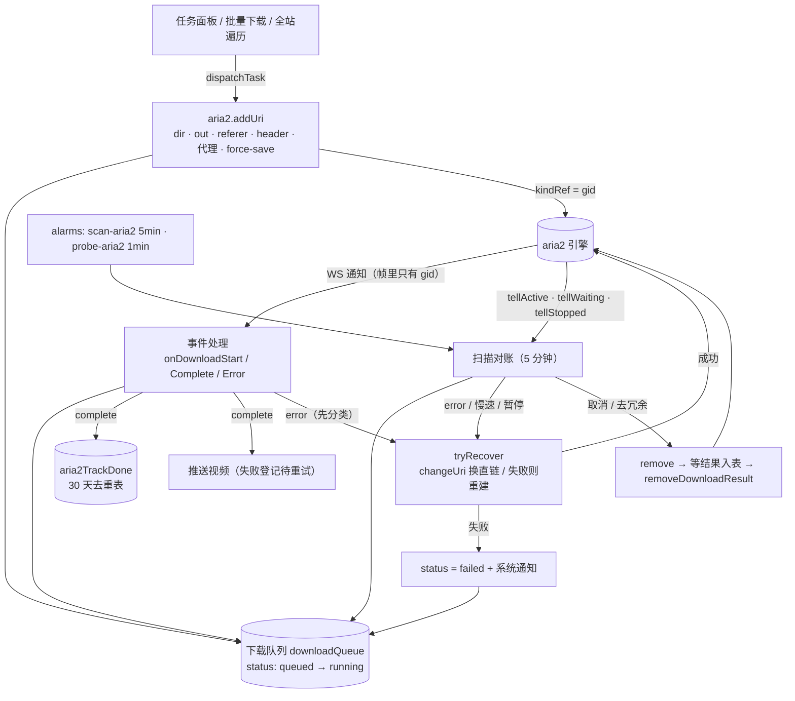
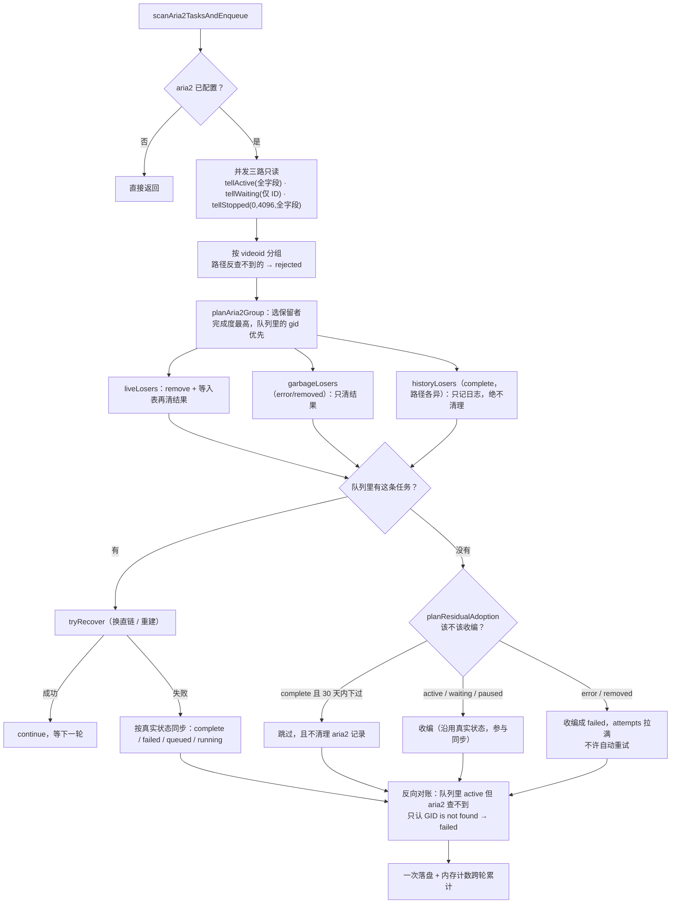
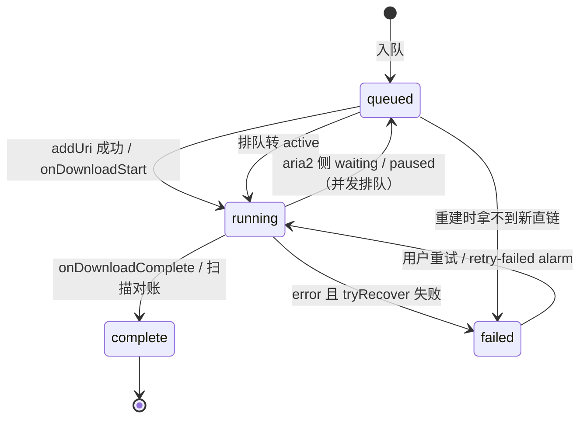
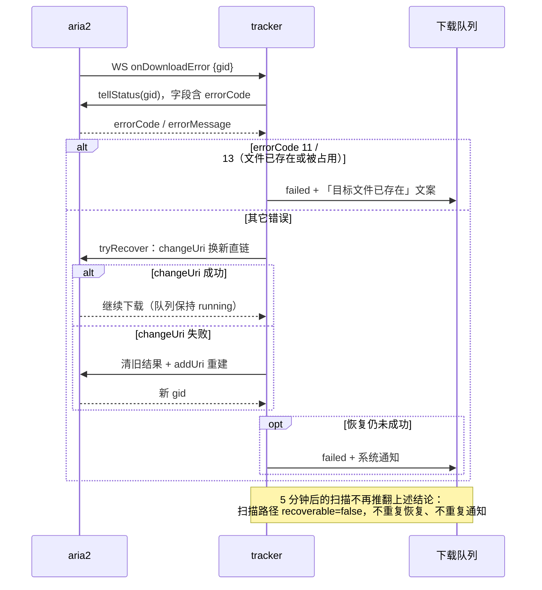
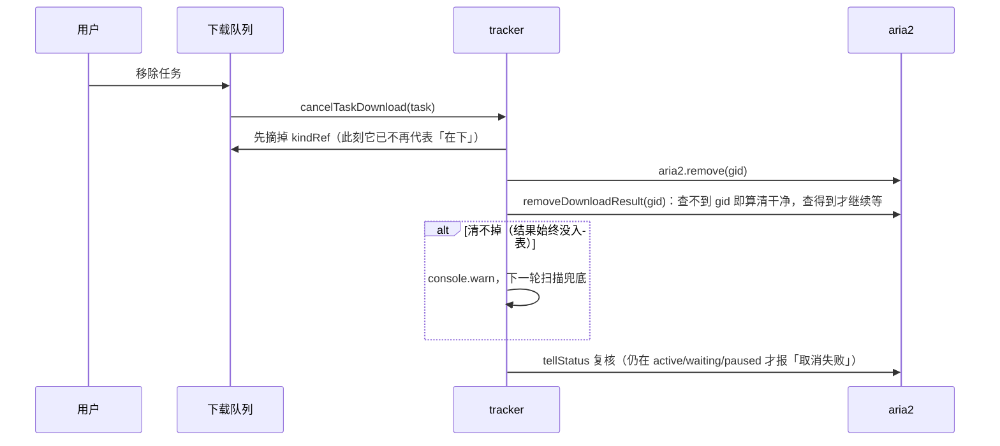

# 08 aria2 下载任务管理：逻辑图

> 本文画的是**当前代码的实际行为**（已含 P0-1 / P0-2 / P0-3 三条修复）。尚未实装的优化见 [aria2-optimization-proposal.md](aria2-optimization-proposal.md)，不要把那份当现状读。

aria2 这条通道只有**三个真相源**：`aria2` 引擎（实际在下什么）、`storage.local.downloadQueue`（界面看到的队列）、WS 通知（尽量及时，但会丢）。三者之间没有事务，全部靠下面的两条路径对齐。

## 1. 一图总览

## 2. 三条入口，职责互斥

| 入口                | 触发                     | 频率         | 唯一的职责                                     | **不**负责                         |
| ------------------- | ------------------------ | ------------ | ---------------------------------------------- | ---------------------------------- |
| 投递 `dispatchTask` | 用户点下载 / 批量 / 遍历 | 事件驱动     | 解析直链 → `addUri` → 写 `running` + `kindRef` | 之后到底下没下成                   |
| WS 事件             | aria2 主动推             | 实时（会丢） | 尽快把终态写回队列与去重表                     | 丢失补偿、断线重放（aria2 不重放） |
| 扫描对账            | `scan-aria2` alarm       | 5 分钟       | 把「aria2 里的真实状态」追平到队列             | 立即性（最长滞后 5 分钟）          |

这就是为什么「已完成的任务还显示下载中」这类现象通常等 5 分钟会自己好——但对账只补终态，**中途的错误要靠事件那一刻就分类**，否则会出现「先报失败、5 分钟后又自己恢复」。

## 3. 扫描对账内部流程

`tellWaiting` 是 P0-1 补上的一路：**`waiting` / `paused` 只在这张表里**（aria2 的并发排队），`tellActive` 看不到、`tellStopped` 也看不到。漏了它，`statusOfAria2` 的 waiting/paused 分支就是永远走不到的死代码，排队中的任务会一直显示「下载中」。

## 4. 状态映射

| aria2 状态          | 队列状态   | 说明                                             |
| ------------------- | ---------- | ------------------------------------------------ |
| （尚未 addUri）     | `queued`   | 只是排在我们自己的队列里                         |
| `active`            | `running`  | 真的在传                                         |
| `waiting`           | `queued`   | aria2 的并发排队，**不是**在下载                 |
| `paused`            | `queued`   | 暂停中；扫描会尝试 unpause（链接过期时先换直链） |
| `complete`          | `complete` | 写去重表 + 推送                                  |
| `error` / `removed` | `failed`   | 先分类（文件冲突单独文案），再尝试恢复           |

## 5. 一次失败的完整时序（P0-2 的修复点）

旧行为是「事件直接判 failed → 扫描又恢复 → 用户看到失败后又自己好了」。现在恢复发生在事件那一刻：链接过期是 iwara 直链的常态，等五分钟才自愈比不修更糟。

## 6. 取消路径（P0-3 的修复点）

先摘 `kindRef` 的原因是：`remove` 会触发事件，如果队列还指着这个 gid，刚被取消的任务会被当成一次失败、甚至触发一次恢复重建——用户点了取消，转头又冒出一条新任务。

`removeDownloadResult` 之所以要带回退判断：`remove` 只置 halt 位，结果要等下一个事件循环才进 `downloadResults_`；早先「remove 紧跟 removeDownloadResult + 空 catch」的写法会静默失败。真机实测（2026-11-18）还发现另一种情况：取消 **waiting** 任务时 gid 会彻底消失、根本不产生结果记录——所以「`GID ... is not found`」必须再问一次 `tellStatus` 才能区分「结果还没入表」与「已经清干净」。

## 7. 看到这些现象时，先别怀疑这条链路

| 现象                                | 真实原因                                            | 不是 bug 的证据                    |
| ----------------------------------- | --------------------------------------------------- | ---------------------------------- |
| 进度条不动，但 aria2 在下           | 浏览器通道拿不到字节进度；aria2 通道靠轮询快照      | 见 AGENTS.md「已知限制」           |
| 刚下完，队列还显示下载中            | WS 事件丢了，等 5 分钟对账                          | 扫描的 complete 分支               |
| 任务在 aria2 里排队，界面显示排队中 | `waiting` 映射成 `queued`                           | 本文第 4 节                        |
| 失败原因写着「未知错误码」          | 只有 aria2 没给 errorCode 时才这样（如被外部 kill） | `ARIA2_STATUS_FIELDS` 含 errorCode |
